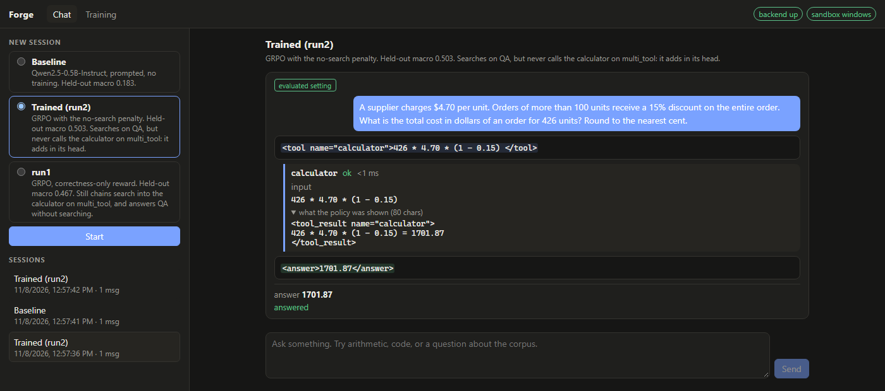
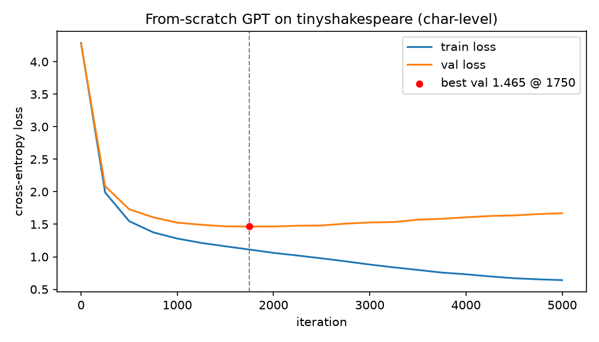
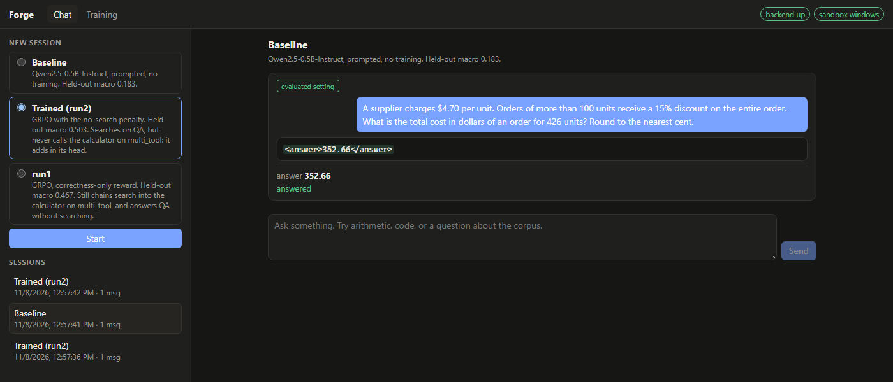
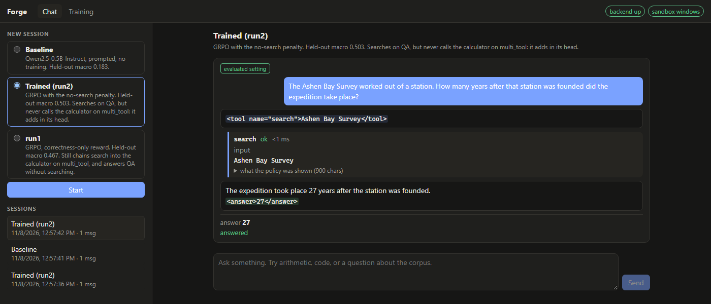
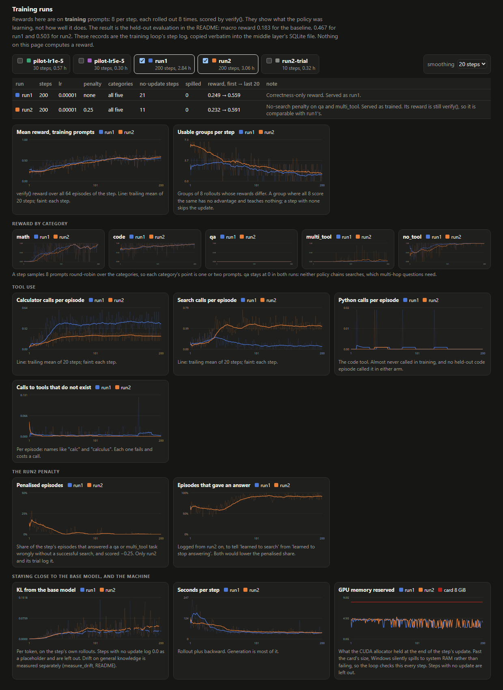

# Forge

[](https://github.com/priyamkuvadiya/Forge/actions/workflows/tests.yml)

Reinforcement learning for LLM tool use on a laptop GPU. A 0.5B open-weight
model (Qwen2.5-0.5B-Instruct) learns when and how to call a calculator, a search
engine and a sandboxed Python runner, trained with a hand-written GRPO loop on
tasks whose answers are checked by code, not by a learned judge. It runs on an
8 GB RTX 4060. The trained policy is served through a Python backend, a Go
middle layer and a React page that shows every tool call as it happens.

## At a glance

**Held-out result: macro-average reward 0.183 → 0.503** (+0.320, 95% CI [+0.277,
+0.364]). That is 148 unseen tasks × 8 attempts per policy, compared task by task
against the prompted base model, with a bootstrap over tasks.

| category | baseline | run1 | run2 (served as "trained") |
| --- | --- | --- | --- |
| math | 0.019 | 0.840 | 0.904 |
| code | 0.408 | 0.564 | 0.634 |
| qa (multi-hop search) | 0.000 | 0.000 | 0.000 |
| multi_tool (search + arithmetic) | 0.000 | 0.008 | 0.058 |
| no_tool (control) | 0.487 | 0.925 | 0.919 |
| **macro** | **0.183** | **0.467** | **0.503** |



**What it does and does not show:**

- **Math is real tool use.** The policy calls the calculator in 99% of math
  episodes instead of 7%. In run1, 377 of 403 correct answers were the
  calculator's exact output.
- **Code and no_tool gains are mostly format.** The policy learned to put its
  answer in the expected tags; it did not learn new skills there.
- **Multi-hop QA did not improve.** The policy searches once and never chains a
  second search. With the right searches handed to it, it still answers only ~20%
  ([why](#why-qa-is-still-0-and-why-there-is-no-third-run)). At the start, these
  tasks gave GRPO no learning signal at all, which was measured before training.
- **Nothing measurable was lost.** No reward hacking was found in the transcripts,
  and a 55-question probe of general knowledge lost no answers at any checkpoint.
- **Only first messages were evaluated.** Follow-ups in the chat were checked by a
  small pilot only.

**Run it** (built and tested on Windows 11 with an NVIDIA GPU, Python 3.14, Go 1.27,
Node 26):

```bash
pip install -r requirements.txt
# the trained adapters (35 MB each) are release assets, not in git:
# download both zips from https://github.com/priyamkuvadiya/Forge/releases/tag/v1.0
# and unzip them in the repo root
python -m demo        # builds the page and middle layer, opens http://127.0.0.1:8080
```

**Where to look:** [held-out results](#held-out-results-baseline-vs-trained) ·
[the second run](#the-second-run-a-penalty-for-answering-without-searching) ·
[the demo](#module-8-the-frontend) · [reward hacking, and how the code sandbox
stops it](#running-untrusted-code-and-not-being-lied-to-by-it) · [fitting GRPO in
8 GB](#fitting-a-training-step-in-8gb).

## Two separate claims

This repo makes two separate claims, kept architecturally and narratively
distinct throughout:

1. **A small transformer language model built from scratch** — a standalone
   proof of understanding transformer internals (attention, positional
   encoding, the training loop). It does not feed the agent below.
2. **An agent whose tool-use policy is trained with RL (GRPO)** — the real
   system, backed by a small pretrained open-weight model (Qwen2.5), not by
   the from-scratch model in (1). An 8GB GPU cannot pretrain a model capable
   enough to be a useful agent backbone.

## How it was built

Complete. It was built module by module, and each section below was written
only after its module existed and had been run for real.

Modules 1 (from-scratch transformer), 2 (task suite and verifiers), 3 (tools,
the sandbox, and the tool-call contract) and 4 (the prompted baseline agent)
are complete, as are 5 (GRPO training), 9 (the held-out evaluation), 6 (the
backend that serves the baseline and trained policies), 7 (the Go middle layer:
sessions, routing, tool execution and SQLite persistence) and 8 (the React frontend:
a chat that shows every tool call as it happens, and the training dashboard).
`python -m demo` starts the whole stack. The Python and Go tests run on Linux and
Windows on every push, and the frontend tests on Linux.

The sequence, in brief. The prompted Qwen2.5-0.5B-Instruct baseline first scored
a macro-average reward of 0.1908, at generation batch size 32. It was re-run at
batch 16 to match the trained arms exactly, and scored **0.183**. Every comparison
uses that 0.183 run, and the 0.008 gap between the two runs is sampling noise. The
baseline calls a tool in under a fifth of episodes in every category —
not once in 160 coding episodes — and when it does call one, it never chains:
of the 72 QA and multi_tool episodes that used a tool, none made a second
call, on the two categories that structurally require more than one hop.
Closing that gap is what module 5's GRPO training has to do.

Module 5 trained the policy with GRPO (200 steps, 2.7 h), and module 9's
paired held-out comparison is the headline result. **Macro-average reward
went from 0.183 to 0.467 (+0.285, 95% CI [+0.248, +0.322])**:

- **Math: 0.02 → 0.84**, through the calculator, which the policy now calls
  in 99% of math episodes instead of 7%.
- **Code: +0.16, and no_tool: +0.44**, mostly from consistently writing the
  answer tags.
- **QA and multi_tool did not move.** At the baseline's skill they produce
  no GRPO gradient at all, which was measured before training. The policy
  still never chains tool calls.
- **Two regressions the reward does not show.** On fictional-corpus QA it
  now guesses without searching instead of declining, and it calls the
  calculator on 35% of the no-tool control tasks.
- **Nothing else measurably lost.** No reward hacking was found, and a probe
  of general knowledge and reasoning lost no answers.

See [the held-out results](#held-out-results-baseline-vs-trained).

A second run added one change to the *training* reward: on qa and
multi_tool, answering without searching scores −0.25 instead of 0. **Held
out, it reaches 0.503 (+0.320 [+0.277, +0.364] over the baseline, +0.036
[+0.006, +0.068] over run 1).** It removed the QA confabulation: answers
given without a search fell from 198 to 0. QA is still 0, because the policy
searches once and never chains, and multi_tool stopped using the calculator.
See [the second run](#the-second-run-a-penalty-for-answering-without-searching).

## Module 1: from-scratch transformer

`transformer_scratch/` — a GPT-style decoder-only transformer (causal
self-attention, learned positional embeddings, pre-LN residual blocks) built
directly on `torch.nn`, trained on the character-level tinyshakespeare
corpus. Exists solely to demonstrate transformer internals are understood
from scratch; it is not used anywhere else in this project.

### Architecture

| | |
| --- | --- |
| Parameters | 10.77M |
| Layers / heads / embedding | 6 / 6 / 384 |
| Context length | 256 characters |
| Vocabulary | 65 characters (built from the corpus, no external tokenizer) |
| Dropout | 0.2 |

Attention, the MLP block, positional embeddings and the training loop are
written directly against `torch.nn` — no `transformers` import anywhere in
this module. Token embedding and output head share weights.

### Training

Trained on tinyshakespeare (1,115,394 characters, 90/10 train/val split) on
a single RTX 4060 Laptop GPU: 5000 iterations, batch 64, AdamW, bf16
autocast, learning rate 1e-3 with 100-iteration linear warmup then cosine
decay to 1e-4, gradient clipping at 1.0. **Wall clock: 15.0 minutes**, peak
3033 MiB VRAM.

### Results

| metric | value |
| --- | --- |
| **Best validation loss** | **1.4652** (iteration 1750) |
| Training loss at that point | 1.1114 |
| Final validation loss (iter 4999) | 1.6703 |
| Final training loss (iter 4999) | 0.6411 |



**The model overfits after iteration ~1750**, and the curve above shows it
plainly: validation loss bottoms out at 1.4652 and then climbs for the
remaining 3250 iterations while training loss keeps falling to 0.6411. This
is expected — 5000 iterations at batch 64 is roughly 73 epochs over a 1.1M
character corpus, so the ceiling here is memorisation, not data.

Two honest consequences:

- The released checkpoint is the **best-validation** one (iteration 1750),
  not the final one. Keeping the final model would have shipped something
  0.205 nats worse.
- 5000 iterations was more than this setup needed. The validation minimum
  arrives around iteration 1750–2000; the remaining ~9 minutes of compute
  bought nothing but overfitting. Left as-is because it makes the
  overfitting visible rather than hiding it behind an early stop.

### Sample output

Generated from the best-validation checkpoint (temperature 0.8, unconditioned):

```text
AUTOLYCUS:
And the lower of much a dufficious hands
at once to make them; Or, and entreats
guides like a life to the merely territ, my
first soul to fight find their harms. My friends sit their
treacherous enemy is an old sins or as mine eagle
My partner doth not between my sister news with them;

DUKE VINCENTIO:
Heavens bring the read in his noble kind heart;
And being and ancient villany of our course,
Good sooth, as if I cannot be assured
To burn his bed back, in pointy a bones
```

This is a fair representative draw, not a best-of-N pick. The model has
learned the *shape* of the corpus — real speaker headings, blank-verse line
breaks, largely well-formed English words and plausible local syntax — but
it is not semantically coherent, and it invents words ("dufficious",
"territ"). That is the expected ceiling for a 10.77M-parameter character-level
model at a validation loss of ~1.47, and it is the honest limit of what this
module claims.

### A note on precision

The first attempt at this run was fp32 and hard-crashed the machine
(Kernel-Power 41, no crash dump — a power cut, not a driver fault). Measuring
before re-running turned out to matter:

| config | peak power | peak temp | peak VRAM | µs/token |
| --- | --- | --- | --- | --- |
| fp32, batch 32 | 115.8 W | 78 °C | 2287 MiB | 15.5 |
| bf16, batch 32 | 82.6 W | 66 °C | 1731 MiB | 9.0 |
| bf16, batch 64 | 81.4 W | 66 °C | 3033 MiB | 9.6 |

bf16 autocast draws ~30% less power, runs 12 °C cooler and is ~1.6x faster
per token than fp32. Batch size barely moves peak power (81.4 W at batch 64
vs 82.6 W at batch 32) because the GPU is already saturated at batch 32 — so
gradient accumulation, which would have been the usual way to keep effective
batch size up under a power ceiling, was measured to be unnecessary here and
was not used.

### Reproducing

```bash
python transformer_scratch/train.py      # ~15 min on an RTX 4060
python transformer_scratch/generate.py --save
pytest transformer_scratch/tests -q      # 6 tests
```

The corpus downloads automatically on first run. Tests cover attention/MLP/
block output shapes, an actual causal-masking correctness check (perturbing a
future token must not change earlier positions' outputs), and an
overfit-one-batch sanity check.

## Module 2: the verifiable-reward task suite

`task_suite/` — the tasks the agent is trained and evaluated on, and the
`verify()` functions that score them. This is the reward signal for the whole
project, so it is built before any agent, tool or training code exists: if the
verifiers are wrong, every reward curve and pass-rate reported later is wrong
with them, and no amount of care in the training loop fixes that.

| split | math | code | qa | multi-tool | no-tool | total |
| --- | --- | --- | --- | --- | --- | --- |
| train | 150 | 30 | 85 | 35 | 40 | 340 |
| held out | 60 | 20 | 33 | 15 | 20 | 148 |

The suite is pinned to `task_suite/data/suite.json` and committed. Everything
that produces it is deterministic, so it could be rebuilt on demand — it is
stored anyway, because an eval number only means something if the tasks behind
it are exactly the tasks that were run, and a file anyone can diff is a
stronger guarantee than "it regenerates the same". A test asserts the
checked-in file still matches a fresh build, so a stale pin surfaces as a
failing test rather than as a quietly wrong number.

### The reward contract

The policy reasons and calls tools however it likes, but has to commit to a
final answer inside `<answer></answer>` for that answer to be scored. Only the
last such block counts, and a response with no parseable commitment scores
0.0 rather than being generously re-parsed. That strictness is deliberate:
format compliance is part of what RL has to learn, and looser parsing — grab
the last number, accept a prefix match — hands out reward for text that never
actually answered the question.

`verify(task, response) -> float` in `[0, 1]` is the single entry point, so
the baseline agent, the GRPO loop and the eval harness cannot drift apart in
how they score.

### How each category is made verifiable

**Math (`tasks_math.py`)** — 10 parameterized templates. The prompt and the
answer are rendered from the same drawn parameters, so a task's answer cannot
disagree with its question; that is the failure mode which quietly corrupts a
hand-written math set. Numbers are drawn to be awkward on purpose — prices to
the cent, non-round rates, multi-step chains — with fewer than 10% of answers
landing on a whole number. If the arithmetic were easy, an improvement in
reward would say nothing about whether the policy learned to use the
calculator. Scoring is a numeric match within a per-task tolerance, which the
template sets (0 for integer answers, half a cent for money).

Their tests assert *properties* rather than recomputing the formula, which
would only prove the code equals itself: compounding grows the principal, two
machines together beat either alone, a weighted average lies between its
inputs, an equal rise and fall ends below the start.

**Code (`tasks_code.py`)** — 50 hand-authored problems, 223 test cases.
Generated instances make no sense here: a coding problem's difficulty lives in
its specification, not its numbers, so thirty instances of one template would
measure one skill thirty times. Held-out coding tasks are therefore different
*problems*, not different instances — the only way a held-out coding score
means anything. There are 20 of them, which is enough for a real effect to
show and still small enough that the eval will have to report it with an
interval rather than as a bare percentage.

Hand-written expected values are exactly where typos hide, so the test file
holds an independently written reference solution for every one of the 50
problems, written from the prompt text rather than from the expectations, and
asserts each scores 1.0 through the real verifier. Two independent derivations
agreeing is what makes the expectations trustworthy. Score is the fraction of
test cases passed, not all-or-nothing — coding is the category where a small
policy most often gets the shape right and one edge case wrong, and a dense
signal there is worth more to GRPO than a cliff.

**Multi-hop QA (`qa_world.py`)** — a 68-document corpus about an invented
research institute, and 118 questions over it. The corpus is fictional on
purpose. A question about the real world can be answered from the base model's
weights without ever calling the search tool, so the reward would be measuring
memorization with no way to tell the two apart. Every entity here is invented,
so retrieval is the only route to a correct answer.

Questions are generated from the entity graph rather than written by hand,
which guarantees every answer is actually supported by the corpus — a
hand-written multi-hop question whose second hop is in no document is an
unanswerable task that silently caps the reward the category can earn, and it
is easy to write one by accident. Each fact lives in exactly one document and
the chains run one way: an expedition's document names its leader but not the
instrument that leader designed, and the researcher's document names the
instrument but not the expedition. A test asserts, for all 118 questions
against the rendered prose, that no single document contains both the entity
the question names and the answer it wants — one careless filler sentence
would turn a two-hop question into a lookup while the question text stayed
identical. Questions run at 2 and 3 hops across 8 templates, each with three
surface phrasings: with one phrasing apiece the category would be eight
sentence moulds, and a policy can learn which slot of which mould holds the
answer instead of learning to retrieve it.

Scoring is exact match on a normalized string against authored alias forms,
not token F1. Overlap credit would reward an answer for merely containing a
right-looking word, and a small policy trained against that learns to stuff
answers with plausible entities.

**Cross-tool (`tasks_multi_tool.py`)** — 50 tasks that need search *and* the
calculator. The other single-tool categories map one-to-one onto a tool: math wants
the calculator, QA wants search, code wants the executor. A policy can infer
which tool to reach for from the shape of the question alone, so RL on those
categories teaches an agent to *use* a tool well but never to *choose* one —
a thin reading of "trained tool-use policy". These tasks put the numbers in
the synthetic corpus, so they have to be retrieved, and make the answer
arithmetic over them, so it has to be computed. Six templates over the same
world: elapsed years, durations, summed instrument masses, vessel length
differences, combined berths.

Two properties are enforced when the tasks are generated rather than hoped
for, because a task failing either is not cross-tool at all — just QA or
arithmetic wearing the other one's clothes. The answer never appears verbatim
in any supporting document, so the arithmetic cannot be skipped by spotting
the result already written down; candidates that would violate this are
dropped, not reworded. And differences are only emitted when they come out
positive, so no task turns on guessing which way round a subtraction was
meant.

**No-tool control (`tasks_no_tool.py`)** — 60 tasks that need no tool at all.
Every other category rewards reaching for one, which makes a policy that
learned "always search" score identically to one that learned *when* to
search. Over-calling is a real trained-policy failure mode and this suite
could not see it. These tasks are single-operation arithmetic on small
integers, counting items listed in the prompt, and questions whose answer is
stated in the prompt — half numeric, half textual, so the control covers
reflexive use of the calculator *and* of search.

Three things are asserted rather than assumed, because a control that
secretly needed a tool would make the measurement built on it meaningless.
The arithmetic stays small enough to do mentally; every comprehension answer
appears verbatim in its own prompt; and none of the invented names appears
anywhere in the search corpus, so a policy that reaches for search gets
nothing back. The splits draw on disjoint pools of operands, names and
vehicles, so held-out means here what it means everywhere else.

**The reward does not penalise a tool call.** Scoring is correctness alone.
What this category enables is a measurement — the call count from the tool
trace — so module 9 can report "the RL policy called a tool on N% of tasks
that needed none" alongside the reward. Folding a penalty into the reward
would be training against a proxy invented here rather than against a
verifiable outcome, which is the thing this whole project avoids.

*Revised after module 5's first run.* The second training run does fold a
penalty into the training reward, on qa and multi_tool only: answering
without any successful search scores −0.25. Held-out scoring is unchanged.
No_tool is still unpenalised. The reasons are in
[the second run](#the-second-run-a-penalty-for-answering-without-searching).

### Running untrusted code, and not being lied to by it

`verify_code.py` never executes anything itself. It builds a self-checking
program and hands it to an injected runner, which module 3 supplies as a real
sandbox. That inversion keeps the verifier pure and unit-testable with a fake
runner, and leaves exactly one place in the repo where untrusted generated
code actually runs — so exactly one place to harden.

The first version of that harness graded itself inside the sandbox and
reported booleans, and a submission could forge the result outright: poisoning
`sys.modules["json"]` so `dumps` returned `"[true, true, true]"` scored 1.0 on
a function that returned the string `"definitely not the answer"`. Since this
is a reward function an RL policy optimizes against, that is a live hole
rather than a curiosity.

It is fixed at the root rather than patched. **The expected answers never
leave the verifier.** The harness carries only the call arguments; it invokes
the function, serializes whatever came back, and the comparison happens here
in trusted code. A submission that wants a passing report line now has to
print the correct return values and has no way to learn what they are —
printing the correct values *is* solving the task. That exact poisoning
submission is now a regression test, alongside one asserting the harness never
contains the string `expected` at all.

### The held-out split

Held-out means something different in each category, and each is enforced by a
test: math draws independent problem parameters from a separate seed, code
holds back entirely different problems, and QA and the cross-tool tasks
partition the question *subjects* so a held-out question asks about an entity
no training question ever mentions. The corpus itself is necessarily shared —
it is the world both splits search. `build_suite()` refuses to return a suite
in which any prompt appears in both splits.

Math is still the largest category, because it is the cheapest to generate.
That is a real imbalance, and it is why every eval number this project reports
is broken down per category rather than pooled into a single headline
pass-rate.

### Reproducing

```bash
python -m task_suite.registry      # rebuild and pin the suite, print the summary
pytest task_suite/tests -q         # 186 tests
```

No reward numbers appear here yet — nothing has been run against these tasks.
The first real numbers arrive with the prompted baseline agent (module 4).

## Module 3: the tools

Three tools the agent can call. Two are safe by construction; the third runs
code a language model wrote, and is the only part of this repo whose isolation
is a design rather than an implementation detail.

### Calculator

Arithmetic parsed with `ast` and walked against a whitelist, never `eval`. The
whitelist is the obvious half. The less obvious half is refusing expressions
that are *valid* but hostile: `9**9**9` is four characters of legal arithmetic
that pins a core and exhausts memory. GRPO will emit millions of expressions
and is under no obligation to emit sensible ones, so guards on exponent size,
estimated result width, expression length and term count are a correctness
requirement, not defensive padding — an unguarded power hangs a training run
with no error to point at.

The tests check sufficiency as well as safety: every one of the suite's 210
math tasks is solved through the calculator to within that task's own
tolerance. A calculator that was safe but could not express the arithmetic
would cap the achievable reward invisibly.

### Search

Hand-rolled BM25 over the pinned 130-document corpus. Whole documents are
returned rather than snippets, because cross-tool answers are arithmetic over
numbers *inside* those documents and a clipped snippet turns a solvable task
into an unsolvable one.

Two properties were measured rather than assumed, and both turned out worse
than expected before they were fixed. A single query used to return a
multi-hop question's entire supporting set for **32 of 118** questions, because
entity classes were small and templated — a question mentioning "vessel"
ranks every vessel document about equally, so a large `k` swept a slice of the
whole class. And because documents rendered from one template score
*identically*, 110 of the 168 retrieval tasks had their top-k cut decided by an
exact score tie rather than by relevance, which made the tie-break — ordering
by `doc_id`, i.e. by entity index — the thing that actually decided what the
agent read.

Three changes, each measured:

| k | 2 | 3 | 4 | 5 | 6 | 7 | 8 | 10 |
| --- | --- | --- | --- | --- | --- | --- | --- | --- |
| 68 docs, partial tied groups | 2 | 2 | 4 | 7 | 14 | 16 | 21 | 32 |
| 130 docs, partial tied groups | 1 | 2 | 2 | 4 | 6 | 7 | 9 | 14 |
| 130 docs, whole groups only | 0 | 1 | 1 | **2** | 2 | 3 | 3 | 4 |

The corpus gained 62 distractor entities that no question asks about and no
answer appears in; results are cut at a tie boundary rather than sampled from
one; and `MAX_TOP_K` is 5 on the strength of the table rather than by taste.
The number of tasks whose first hop is unreachable is **0 at every k in every
row**, so none of this costs solvability.

A consequence worth stating because it looks like a bug: a query too broad to
discriminate returns *nothing*. Searching "vessel" matches all 32 vessel
documents equally, and there is no honest way to pick five of them — coming
back empty tells the policy its query does not narrow anything down, which is
the thing it needs to learn.

### The code sandbox

`code_exec.py` picks a backend and presents one interface, because everything
above it should neither know nor care which it got.

**Windows** — an AppContainer, a Job Object, and a suspended start, each
closing something the others do not. There is no Docker and no WSL on the
development machine, and Python on Windows has no `resource` module, so
`fork` + `setrlimit` was never available here.

- **AppContainer** confines what the process can *reach*. This is the part
  that matters for reward hacking. The first version did not have it, and a
  probe showed a submission could hardcode the repo path and read
  `task_suite/data/suite.json` — the expected answers for its own task. The
  suite withholds those answers from the harness precisely so a passing line
  requires computing them, and that defence is worth nothing if they are
  readable from disk. Network access is refused too.
- **Job Object** confines what it can *consume*: memory caps so an allocation
  fails as `MemoryError` instead of swapping the machine, `ActiveProcessLimit
  = 1` so a fork bomb fails at its first spawn, kill-on-close, and
  die-on-unhandled-exception so a crash cannot raise a modal dialog and hang
  an unattended run.
- **`CREATE_SUSPENDED`** removes the assignment race: the process is created
  suspended, put in the job, and only then resumed.

A sandboxed run costs **285 ms**, of which **249 ms** is bare CPython startup
on Windows — the isolation machinery is about 40 ms. That matters because the
usual argument for a subprocess over a container is speed, and measured, it
mostly isn't: a container pays the same interpreter cost on top of its own.
The honest case against a container here is the multi-gigabyte install
becoming a dependency for anyone reproducing this project's numbers.

The sandbox tests run real fork bombs, real memory bombs and real infinite
loops rather than asserting the happy path, and a separate integration file
runs all 50 coding problems' reference solutions through the real verifier and
the real sandbox, requiring 1.0 on every one — so that no isolation constraint
silently depresses the category's reward.

**POSIX** — `fork` plus `setrlimit`: address-space and CPU caps, `RLIMIT_NPROC
= 1` so a fork bomb fails at its first spawn, a file-size cap, no core dumps,
and the child in its own session so a timeout kills the whole process group.
It exists because a runner that only works on one laptop makes the coding
category unreproducible, which fails this project's own bar.

One honest caveat, also stated at the top of `code_exec_posix.py`: **it does
not confine the filesystem**. Proper confinement needs a mount namespace,
which needs root or user namespaces, neither of which can be assumed — so on
POSIX a submission can still read the repo and therefore the expected answers,
the exact hole the AppContainer closes on Windows. Landlock would close it
properly and is deliberately not built: it cannot be tested on the machine
this project is developed on, and a silent no-op on an unsupported kernel
would be a *worse* failure than the documented gap, because it would look
closed.

**So the verifier refuses to score through it instead.** A runner declares
whether it confines the filesystem, and `verify()` raises rather than
returning a number when it does not — the same stance it already takes when
there is no runner at all, and for the same reason: a score a submission
could have obtained by reading `suite.json` is indistinguishable afterwards
from an honest one, and 0.0 would look like a model that cannot code.
`--allow-unconfined` overrides it for cases that publish no number (the
sandbox's own tests, smoke runs), and the results file records that it was
used, so a caveated number can never be mistaken for a clean one:

```json
"sandbox": {
  "backend": "windows",
  "confinement": "appcontainer+job (confines: filesystem, network, resources)",
  "filesystem_confined": true,
  "allow_unconfined": false
}
```

The refusal fires in `baseline_agent` as a preflight, before the model loads,
rather than half an hour into generation. Because this machine can never
produce the condition, the behaviour is tested by a fake runner that declares
itself unconfined, and the whole suite was additionally run with
`confinement()` patched to report an unbounded filesystem — which is how the
four integration tests that legitimately need the override were found before
CI did.

That difference is data rather than prose. Each backend declares a
`Confinement` — what it bounds and what it does not — the eval harness records
it beside every coding score, and `python -m tools.code_exec` prints it with a
loud warning when the filesystem is unconfined. A coding number therefore
always says which boundary produced it, instead of a Linux result looking
identical to a Windows one. The tests asserting filesystem and network
confinement are marked Windows-only for the same reason: so they cannot skip
quietly and imply a boundary that is not there.

It was written blind — there is no Linux, WSL or container runtime on the
development machine — which is exactly why CI runs the full suite on
`ubuntu-latest` on every push (424 passed, 8 Windows-only tests skipped). That
was not ceremony: the first Linux run found two real bugs, both of which would
have shipped as silent reward bugs rather than as visible failures.
`RLIMIT_NPROC = 1`, copied across from the Windows job object's
`ActiveProcessLimit = 1`, blocks *threads* on Linux because a thread is a
task — so any solution using `threading` would have scored 0. And the same run
on Windows CI showed the harness could not open the null device inside a fresh
AppContainer, which made *every* coding task score 0 there while passing
locally. Both look exactly like a model that cannot code.

Known limits on Windows too, stated rather than glossed: the child runs as the
calling user, and everything it *is* granted — the interpreter directory, its
own scratch space — it can read. This is a strong boundary against a model that wanders
into the repo and a weak one against an attacker who already has local code
execution.

### One contract for calling them

`toolbox.py` is what the rest of the project actually talks to. Without it,
each of modules 4, 5, 7 and 9 would have invented its own way to name a tool,
parse a call and record what happened — slightly differently.

The policy emits `<tool name="calculator">2 + 2</tool>`, deliberately shaped
like the `<answer>` contract so there is one syntax to learn, not two. Every
tool returns the same `ToolResult`, and every failure — bad syntax, unknown
tool, a refused expression, a timeout — comes back as a result rather than an
exception, because one bad tool call is ordinary policy behaviour that should
cost reward, not abort a rollout.

A `ToolSession` wraps one task attempt with a call budget (8 by default;
the longest legitimate chain in the suite is a three-hop QA question) and a
trace of every call, its arguments, its result and its duration. That trace is
not bookkeeping: module 7 stores it in SQLite for the live reasoning view, and
module 9 needs the call counts to answer the question the no-tool category
exists to ask. Exhausting the budget returns a message telling the policy to
answer with what it has, rather than silently dropping the call — a policy
that is ignored learns nothing.

The prompt describing the tools is generated from the registry, so it can
never advertise a tool that is not present — a live risk here, since the
sandbox is platform-specific and a registry built without it must not promise
a `python` tool the policy would waste its whole budget discovering is absent.

### Reproducing

```bash
python -m tools.code_exec --setup   # one-time, ~90s on Windows
python -m tools.code_exec           # report the backend and what it confines
pytest tools/tests -q               # 246 tests, including the adversarial ones
```

The setup step creates the AppContainer profile and grants it read access to
the interpreter directory — an `icacls` pass over roughly 50,000 files. It is
idempotent, marker-guarded on both the container SID and the interpreter (so a
Python upgrade re-does it rather than failing obscurely), and happens once per
machine. It is an explicit command rather than a lazy side effect of the first
sandboxed call, because as a side effect it is indistinguishable from a hang.

`python -m tools.code_exec` with no arguments prints which backend is active
and what it confines, and warns loudly when the filesystem is not confined.
The same value is recorded by the eval harness beside every coding score, so a
number always says which boundary produced it:

```text
backend:     windows
confinement: appcontainer+job (confines: filesystem, network, resources)
```

Runs are independent and the sandbox is thread-safe: measured on this machine,
16 runs take 5.6 s serially and 0.8 s across 8 workers, so an effective 49 ms
per run rather than 285 ms. Module 5 should execute code rollouts in parallel
for that reason — with the caveat that each concurrent run may hold up to the
256 MB memory cap, so the worker count is a RAM budget, not a free lunch.

## Module 4: the prompted baseline agent

`baseline_agent.py` — **Qwen2.5-0.5B-Instruct**, prompted rather than trained,
using the module 3 tools on the module 2 tasks. This is the control group. It
is the reason any later claim about RL can be checked, and the numbers below
are what module 5's trained policy has to beat.

Nothing in this module trains anything. The backbone is an off-the-shelf
open-weight model, loaded in bf16, and the only thing that changes between
this arm and the RL arm is the weights: same system prompt, same worked
examples, same tool contract, same 8-call budget, same verifiers, same
sampling parameters.

### The loop

An episode is a chat transcript. The policy writes a turn; if it ends in
`<tool name="...">...</tool>` the call runs and the result comes back as the
next message; if it contains `<answer>...</answer>` the episode is over and
`task_suite.verify()` scores it. Three details are worth pulling out:

- **Generation stops at `</tool>` or `</answer>`**, and everything the model
  writes after its own tool call is discarded. That is not tidiness. A small
  model routinely writes `<tool name="search">...</tool>` and then invents the
  `<tool_result>` block it is about to be handed, together with an answer
  derived from it. Keeping that text would let an episode collect reward off a
  fabricated retrieval, and would teach module 5's policy to hallucinate tool
  output as a strategy.
- **All live episodes step in lockstep**, so each generation call sees a full
  batch and finished episodes drop out. The tool calls a batch produces are
  then executed together on a thread pool, which is what makes the sandbox's
  measured 49 ms-across-8-workers matter. Run one episode at a time and the
  held-out eval below goes from half an hour to most of a day.
- **The policy interface is `conversations -> completions` and nothing else.**
  Chat templating, padding and sampling live in the backbone, so the loop
  itself is driven by scripted policies in CI, on both platforms, with no
  torch installed. The truncation rule, the answer/tool-call ordering rule,
  the budget and the nudge are all text handling, and a GPU adds nothing to
  testing them.

### What the dry run changed

The suite was frozen only *after* a throwaway probe against the real model, on
the **train** split, because a task-suite change after the baseline is
recorded invalidates the baseline. Four things came out of it, and the first
is the one that matters:

**Prompted from a description alone, the model scored 0.000 in every
category.** Across a ten-task probe it emitted zero `<answer>` blocks and zero
tool calls. It solved "What is 5 plus 4?" correctly in prose and scored 0.0;
asked about a fictional expedition, it apologised for not knowing instead of
searching for it. A baseline of zero everywhere is arithmetically honest and
analytically worthless — it measures whether a 0.5B model can infer an
unfamiliar tag convention from prose, which is not what this project claims RL
improves, and it would hand module 5 a guaranteed win over a control that
never attempted the task.

So the control gets the prompt a competent engineer would actually ship: four
worked examples replayed as real conversation turns — a direct answer, a
coding answer, a calculator call, a search call. They are invented and
deliberately unlike anything in the suite, their tool results are produced by
the real `calculate`, `render_hits` and `ToolResult.render` rather than typed
out, and module 5's policy is prompted with exactly the same turns.
`--no-few-shot` exists so their value can be quoted rather than guessed at,
and it is quoted below: they are worth fifteen times the macro reward, almost
all of it output-format compliance.

One of them was quietly cheating and a test caught it. The first direct-answer
example was "What is 3 plus 6?", which is *verbatim* `notool-train-0030` — the
worked example was handing the policy a solved task from the very category
that exists to measure it. `test_few_shot_examples_leak_no_task_from_the_suite`
now checks every exemplar against every task prompt, every corpus document
title and every coding entry point.

**The recovery nudge went through three wordings, and two of them destroyed
answers the model had already got right.** If a turn ends with neither a tool
call nor an answer, the agent asks once for the answer in tags. "Give it now,
using what you already know" was read as an invitation to start over, and a
correct fenced `sum_of_evens` came back as `<answer>0</answer>`. Adding "if
the task was to write a function, put the function in the tags" fixed coding
and broke arithmetic instead — three math episodes that had reasoned their way
to a number in prose came back as Python function definitions. Showing the
shape as a fill-in template, `<answer>YOUR ANSWER</answer>`, got the tags back
and lost the answer: five episodes answered the literal string "YOUR ANSWER".
The wording that survived says only where the two literal strings go.

**One task in the suite had no determinate answer, and the base model was
right to say so.** The `no_tool` counting template read "A box contains
bottles, folders and chairs. How many items are in the box?" — the pool is
plural nouns, so the stated answer of 3 was really a count of *kinds*. The
model refused, correctly. A task whose stated answer is wrong is worse than a
hard task: it is reward for agreeing with the author. The prompt now asks for
kinds. This is the whole reason the dry run happens before the freeze.

**The nudge recovers format, not correctness — measured.** Over 200 train
episodes with and without it, answer rate moves a great deal (QA 0.075 →
0.300, `no_tool` 0.425 → 0.600) and macro reward does not move at all (0.205 →
0.200). The answers it rescues were wrong anyway. It stays on by default
because it separates a format failure from a task failure, which module 9
needs and the reward curve cannot show; it is now on the record that it costs
an extra turn and buys no reward.

### Baseline results, held out

All 148 held-out tasks, 8 rollouts each — 1184 episodes in 18.3 minutes on the
RTX 4060. Qwen2.5-0.5B-Instruct in bf16, temperature 0.7, top-p 0.9, an 8-call
tool budget, and one recovery nudge. Coding was scored under
`appcontainer+job (confines: filesystem, network, resources)`; the full record,
including every per-episode reward and tool trace, is in
`artifacts/baseline/heldout.json`.

| category | tasks | episodes | mean reward | 95% CI | solved | answer rate | nudged | any tool |
| --- | --- | --- | --- | --- | --- | --- | --- | --- |
| math | 60 | 480 | 0.021 | [0.006, 0.042] | 0.021 | 0.756 | 0.377 | 0.071 |
| code | 20 | 160 | 0.439 | [0.342, 0.543] | 0.281 | 0.894 | 0.106 | 0.000 |
| qa | 33 | 264 | 0.000 | [0.000, 0.000] | 0.000 | 0.379 | 0.875 | 0.178 |
| multi_tool | 15 | 120 | 0.000 | [0.000, 0.000] | 0.000 | 0.433 | 0.817 | 0.208 |
| no_tool | 20 | 160 | 0.494 | [0.331, 0.650] | 0.494 | 0.719 | 0.431 | 0.062 |

**Macro-average reward: 0.1908**, the unweighted mean of the five category
means. That is the number module 5 has to beat. Intervals are percentile
bootstraps resampled over **tasks**, not episodes — eight rollouts of one
question are eight draws from one question, and resampling episodes would
report a confidence the 20-problem coding split does not have.

**The model barely uses tools at all, and that is the headline.** It called a
tool in 7% of math episodes, 18% of QA, 21% of multi_tool, and — on 160 coding
episodes with a Python sandbox available and advertised in its prompt —
**zero times**. Prompted with four worked examples including a calculator call
and a search call, a 0.5B model still overwhelmingly answers from its own
weights. That gap is exactly what this project claims RL closes, and it is now
a measured number rather than an assumption.

**It never chains.** 116 of the 1184 episodes called a tool at all, and 114 of
those made exactly one call. On QA and multi_tool — the two categories that
structurally *require* more than one hop, since the supporting facts are
deliberately spread across documents — **not one of the 72 episodes that
called a tool ever called a second time.** The baseline does not do multi-hop
retrieval; it does one search and then commits. Sequential tool use is not a
weak spot in the control, it is absent from it.

One caveat on the QA split, stated here rather than left in a test: **2 of the
33 held-out multi-hop QA tasks can have their whole supporting set returned by
a single search** (`qa-heldout-0003` and `qa-heldout-0028`), against 0 of 85
in train. That is 6% of the split the reported number comes from, and the
pooled "2 of 118" framing would have hidden the concentration. It is bounded
rather than fixed: no single *document* answers either question, so a policy
must still read what came back and work out which retrieved neighbour is the
answer — what the shortcut saves is the second search *call*, not the
reasoning. The count is asserted exactly in `tools/tests/test_search.py`, as
is the fact that raising the retrieval cap from 5 to 10 would double it.

**Retrieval is not the only gap, which matters for what RL has to learn.** On
QA, episodes that searched scored 0.000 and episodes that searched nothing
also scored 0.000. Searching moved the answer *rate* (multi_tool 0.379 →
0.640) without moving reward at all. So the model cannot yet use what it
retrieves, and a policy that merely learned "call search more often" would not
move these numbers. The answers it produces instead are confabulations with a
real-world shape — `"British Geological Survey (BGS)"`, `"Portsmouth Naval
Base in England"`, `"Newcastle upon Tyne"` — against a corpus that is
fictional precisely so that answering it requires retrieval. Module 2 made
that choice to stop the reward measuring memorisation, and this is the
evidence it was the right one.

**Nothing ran out of room.** Every episode ended by answering (773) or by
declining to (411); exactly one of 1184 exhausted the 8-call budget and none
hit the turn cap. The zeros above are the model failing the task, not the
harness truncating it — worth establishing, because a loop that quietly
strangled its own episodes would produce the same table.

**This breaks the `no_tool` control, and the control has to say so.** That
category scores a 0.062 tool-call rate, which looks like a policy that knows
when not to reach for a tool. It isn't: the model scarcely reaches for one
anywhere, so the low rate is a property of the whole arm, not discrimination
between task types. The measurement only becomes meaningful once an arm uses
tools at all. Module 9 must report it as a *pair* with the other categories'
rates, never alone.

Three episodes invented a tool that does not exist (`calc`, `calculation`, and
— conflating the two contracts — `answer`). At 2.6% of tool-calling episodes
that is a footnote rather than a finding, but it is the cost of having
deliberately made `<tool>` and `<answer>` look alike, and it is cheap to watch
for once a trained policy starts calling tools in earnest.

**Math is 0.021 because of arithmetic, not formatting.** The split over 480
episodes: 66.9% produced a parseable number that was simply wrong, 24.4%
never emitted an `<answer>` block, 6.7% emitted something unparseable, 2.1%
were correct. So roughly a third is format failure and two thirds is
arithmetic — the verifier is not the bottleneck. Thirteen answers landed
within 2% of the target but outside the 0.005 tolerance; that tolerance is
correct for money rounded to cents, and widening it to collect those would be
tuning the ruler to flatter the result.

Two of the unparseable answers are worth quoting, because they are failures of
this repo's own prompt rather than of the model: `"immediately before it and
the literal text"` is the model parroting the answer-format instruction back,
and `"That reply cannot be scored because it did not contain the answer
tags."` is it echoing the recovery nudge. The nudge wording survived three
rewrites already (above); this is a fourth failure mode it has, and it is on
the record rather than quietly fixed after the freeze.

**Coding's dense score is doing real work.** Of 160 episodes, 28.1% passed
every test, 35.0% passed some, and 36.9% passed none. Reported as
solved/unsolved this category would be 0.281 and would throw away the 35% that
carry most of the gradient signal GRPO will use. It is 0.439 as a fraction of
223 test cases, and the ±0.10 interval on 20 problems is why the project's
eval rules forbid quoting it as a bare percentage.

**`no_tool`'s 0.494 is two different numbers.** Split by task kind, the
arithmetic half scores 0.646 and the reading-comprehension half 0.266. The
category mean is a blend of a thing the model can do and a thing it cannot.

**Checked for reward hacking; found none.** The coding answers were scanned
for `sys.modules` poisoning (the attack that already beat an earlier version
of this harness), sentinel forgery, reading `suite.json`, `builtins` patching
and early clean exits. One submission matched on the word `expected` and turned
out to be writing its own unit tests with an `expected_output` variable, and it
scored 0.0 anyway. No QA or multi_tool episode scored above zero without a tool
call. Ten perfect scores had answers under two characters and all were
`no_tool` tasks whose correct answer really is `3` or `5`.

### What the worked examples are worth

The same 1184 held-out episodes with `--no-few-shot`, which removes the four
worked examples and leaves the description of each tool intact:

| category | with examples | without | answer rate | any tool |
| --- | --- | --- | --- | --- |
| math | 0.021 | 0.006 | 0.756 → 0.283 | 0.071 → 0.015 |
| code | 0.439 | **0.000** | 0.894 → 0.019 | 0.000 → 0.000 |
| qa | 0.000 | 0.000 | 0.379 → 0.053 | 0.178 → **0.000** |
| multi_tool | 0.000 | 0.000 | 0.433 → 0.158 | 0.208 → 0.025 |
| no_tool | 0.494 | 0.056 | 0.719 → 0.106 | 0.062 → 0.006 |
| **macro** | **0.1908** | **0.0125** | | |

Fifteen times the reward, and the mechanism is almost entirely the output
contract rather than capability. Without the examples the model essentially
stops emitting `<answer>` tags — coding goes from 0.894 to 0.019 — and the
recovery nudge fires on 93-100% of episodes in every category without
rescuing them. The coding score falls to exactly zero not because the model
forgot how to write Python but because it stops putting it where the verifier
looks.

The tool columns say something narrower and more interesting: **the search
example is the only reason QA ever searches at all** (0.178 → 0.000). Told in
prose that a search tool exists, a 0.5B model does not use it once in 264
episodes. Shown one example of a search call, it uses it in 18% of them — and
still scores 0.000, which is the same point the main results make.

This is why the control is prompted this way. A description-only baseline
would score 0.0125 and would hand module 5 a fifteen-fold improvement that is
mostly a lesson in tag syntax. The RL arm is prompted with exactly these same
turns, so whatever it gains is gained over a control that already knows the
format.

### Why batch size 32, on a card with room for 48

The first complete held-out run used batch 48 and took 45 minutes. The second
used batch 32 and did the same work in 18. That is backwards until you measure
what the card is actually doing (Qwen2.5-0.5B-Instruct, bf16,
`max_new_tokens=256`):

| batch | prompt tokens | cuda_reserved | tok/s | board W | |
| --- | --- | --- | --- | --- | --- |
| 32 | 1517 | 4.09 GB | 432.7 | 88.2 | fits in VRAM |
| 48 | 1517 | 5.61 GB | 458.1 | 91.5 | fits in VRAM |
| 48 | 3029 | 9.26 GB | 152.9 | 94.9 | spilled to system RAM |
| 48 | 4541 | 15.03 GB | 41.0 | 95.7 | spilled to system RAM |

**An 8GB card on Windows does not enforce 8GB.** WDDM backs the overflow with
system RAM, so exceeding the card never raises `CUDA out of memory` — it
silently costs up to 11x throughput. Batch 48 is genuinely faster than 32
while the transcripts are short, and collapses once a few episodes accumulate
enough tool output to push the batch past the card. Agent rollouts make that
unavoidable: transcript length is set by how many tools the policy decides to
call, so the widest batch in a run is not something the batch size alone
predicts.

Two things worth recording for anyone measuring this themselves. Board power
is *not* the signal — spilling draws 95 W, slightly more than a healthy run,
so a slow run looks perfectly busy. The check that works is
`torch.cuda.memory_reserved()` against the device's `total_memory`. And host
commit charge tracks the GPU reservation almost exactly, at
`commit ≈ cuda_reserved + 3.4 GB` across every configuration measured, which
is how a 0.5B model drove a 16GB machine to 97% of its commit limit.

Two plausible culprits were tested and neither was responsible: `stop_strings`
costs 0.20 GB rather than the gigabytes guessed, and
`PYTORCH_CUDA_ALLOC_CONF=expandable_segments:True` changes nothing measurable.
There is no leak — the reservation plateaus within about four calls in every
configuration.

### Reproducing

```bash
python -m baseline_agent --split heldout --rollouts 8 \
    --batch-size 32 --tool-workers 4 \
    --out artifacts/baseline/heldout.json
```

Generation is checkpointed to `<out>.rollouts.json` *before* scoring, and
`--score-rollouts <path>` re-scores that checkpoint with no GPU. That is not a
convenience: the first complete held-out run was destroyed by a `SandboxError`
raised during scoring, after all 40 minutes of generation had finished and
before anything was written. The transcripts and the rollouts checkpoint are
not committed — only `heldout.json`, which is what module 9 reads.

## Module 5: GRPO training

The RL half. A LoRA-adapted Qwen2.5-0.5B-Instruct is trained with GRPO on the
module 2 task suite, using the module 2 verifiers as the reward and the module
3 tools through the module 3 contract. One step is:

```text
draw a category-balanced set of prompts      rl_training/sampling.py
roll out `group_size` attempts at each       baseline_agent.run_episodes
score every attempt                          task_suite.verify
centre each reward on its group              rl_training/advantages.py
mask each transcript to the policy's tokens  rl_training/transcript.py
accumulate a gradient over microbatches      rl_training/objective.py
one optimiser step
```

Everything but the optimiser is code the earlier modules already own. The
rollouts come from the *same* `run_episodes` that produced the baseline,
scored by the *same* `verify`, through the *same* tool contract — so module
9's comparison measures two sets of weights and not two different agents.

**8,798,208 trainable parameters of 502,830,976.** LoRA r=16 on every
attention and MLP projection. That is not a concession to the card, it is what
makes training possible on it: full fine-tuning needs optimiser state for all
502.8M. It also buys the KL reference for free — `disable_adapter()` turns the
resident weights back into the base policy, so there is no second copy of the
model and no drift, the KL is always measured against the model module 4
benchmarked.

### Most prompts produce no gradient at all, and the reward curve cannot show it

GRPO's one idea is that you do not need a value network to know whether a
rollout was good: sample a *group* of rollouts from the same prompt and score
each against its own group's mean. The group is the baseline, which is why
there is no critic and why this fits on 8GB.

The consequence is not advertised anywhere: **a group whose rollouts all
scored the same contributes nothing.** Every advantage in it is zero, the
prompt is bought and thrown away, and a run where 90% of groups are like that
looks exactly like a run that is learning slowly.

Run against module 4's per-episode rewards, 8 rollouts per task. The train
split is the distribution GRPO actually samples from; held-out was measured
first and served as a proxy until the train-split baseline existed
(`artifacts/baseline/train.json`, 2720 episodes, 57.9 min, same
configuration as the held-out run, macro reward 0.2137):

| category | usable groups, train | usable groups, held-out |
| --- | --- | --- |
| code | 25/30 (0.833) | 19/20 (0.950) |
| no_tool | 34/40 (0.850) | 13/20 (0.650) |
| math | 15/150 (0.100) | 7/60 (0.117) |
| qa | **0/85** | **0/33** |
| multi_tool | **0/35** | **0/15** |
| **pooled** | **74/340 (21.8%)** | **39/148 (26.4%)** |
| **category-balanced** | **35.7%** | **34.3%** |

**78.2% of train prompts are dead, and QA and multi_tool are entirely dead on
both splits** — the two categories module 4 identified as the gap, the two
that structurally require chaining. The proxy was slightly optimistic. The
chaining gap reproduces too: of 259 train-split qa/multi_tool episodes that
called a tool, 3 called more than once (held-out: 0 of 72). The rollouts were
audited for the known reward hacks (`sys.modules`, `suite.json`, `open(`,
`__import__`, `builtins`) and none appear.

The pooled figure is not quite what training sees. The sampler is
category-balanced (below), so a step draws from each category equally and the
fraction that matters is the unweighted mean of the per-category rates:
**64.3% dead on train**. Math's share of the pool is what pushes the pooled
figure higher. Both are reported because both are true; neither is small. At
the default four prompts per step that is **1.43 usable groups per step on
average, and 7.1% of steps with no gradient at all** (assuming independent
draws — `P(dead step)` is 30% at two prompts per step and 0.3% at eight). GRPO can only sharpen a distinction the policy already
sometimes makes, and on those two it never makes it. A bigger group does not
help: the probability that a group of `k` binary rollouts all agree is
`p^k + (1-p)^k`, which at `p = 0.05` needs `k = 32` to get the dead fraction
under 20% and at `p = 0` is 1 for every `k`.

| per-rollout success `p` | k=4 | k=8 | k=16 | k=32 |
| --- | --- | --- | --- | --- |
| 0.02 | 0.922 | 0.851 | 0.724 | 0.524 |
| 0.05 | 0.815 | 0.663 | 0.440 | 0.194 |
| 0.10 | 0.656 | 0.430 | 0.185 | 0.034 |
| 0.20 | 0.411 | 0.168 | 0.028 | 0.001 |

This is measured before training rather than discovered after it
(`rl_training/advantages.py::expected_signal_rate`), it is logged next to the
reward on every step, and it sets an honest ceiling on what this module can
claim. Whatever module 9 reports, it cannot be that GRPO taught this policy
multi-hop retrieval from a standing start of zero.

Degenerate groups are dropped before the backward pass rather than multiplied
by a zero advantage — at 64–78% dead that is most of the budget. Dropping them has
to be a *compute* saving and nothing else, which is subtler than it sounds:
they contribute zero to the numerator, so leaving them out of the
**denominator** as well would scale the surviving gradient by the reciprocal
of the usable fraction — a silent ~3–4.6x on the effective learning rate,
drifting step to step with however many groups happened to be degenerate. So
every episode contributes its tokens to the normalizer and only the non-zero
ones reach a microbatch, with a test asserting the gradients are identical
either way. The one real caveat: with `kl_beta > 0` the dropped sequences
would also have carried a KL penalty, so `--keep-degenerate` exists.

### The mask is the part that has to be exact

An episode interleaves text the policy wrote with text it read. The tool
output is the latter, and on QA it is a verbatim corpus document — training on
it would teach the model to predict search results. So every transcript
carries a mask, and an off-by-one at a message boundary either drops a real
token from the objective or trains on `<|im_start|>`, with the reward curve
looking identical either way.

Two properties of Qwen's chat template make an exact mask possible, and both
are checked against the live tokenizer rather than assumed: rendering a prefix
of the conversation produces an exact string prefix of the whole render, and
tokenizing a rendered prefix produces a prefix of the whole tokenization. A
guard re-checks the first on every call, with a mutation test proving the
guard fires.

**The policy's turns are spliced in as the ids it actually sampled, not as a
re-encoding of its decoded text.** The agent loop stores decoded strings, and
re-encoding a decoded string is only *usually* the identity; where it is not,
the gradient is on a token sequence the policy never emitted. On the early
smoke runs that shortcut would have cost nothing — 0 of 27 turns diverged —
and the count was reported per step (`divergent_turns` / `measured_turns`)
rather than asserted to be negligible for exactly that reason. The pilot runs
below measured it properly: **3.6–6.0% of turns diverge** once the policy
starts moving, so the safeguard is doing real work.

One bug found here is worth recording because nothing would have caught it
downstream: **the prompt prefix contains assistant messages, because the
few-shot worked examples are assistant messages.** Masked in, every rollout
would have been a policy-gradient step *and* a supervised step on three
hand-written demonstrations. Module 4 measured those demonstrations as worth
0.1908 against 0.0125, so a policy quietly trained to reproduce them would
have looked exactly like RL succeeding.

### Fitting a training step in 8GB

Two facts decide the whole design, and both were measured with the code that
spends the memory (`python -m rl_training.measure_budget`, recorded in
`artifacts/rl/budget.json`).

**`from_pretrained` returns a model in eval mode, and gradient checkpointing
is a silent no-op there.** `transformers` 5.x guards it on
`self.gradient_checkpointing and self.training`; every flag reads `True`, no
warning is issued, and the memory simply never drops. At batch 2 × 1024 the
body's forward-and-backward costs 7.90 GiB in eval mode against 1.55 GiB in
train mode — **5.08x, and that is a lower bound**, because the eval-mode
measurement itself spilled (8.29 GiB reserved on an 8.00 GiB card) so its true
cost is higher than the peak recorded. `prepare_for_training` asserts
checkpointing engaged on every layer rather than reading the flag back, since
the flag is the thing that lies.

**The vocabulary projection is the big tensor, not the transformer.** Hidden
size 896 against a vocabulary of 151,936, and the loss upcasts the logits to
fp32 and needs a gradient of the same shape. Chunking the head is not enough
on its own — autograd keeps every chunk's graph alive until the single
backward, so all the chunks stay resident and nothing is saved. So the
backward runs **per chunk** against a detached copy of the hidden states,
accumulating into that copy's `.grad`, and only then pushes the accumulated
gradient through the body once.

| batch × seq | peak | reserved | seconds | |
| --- | --- | --- | --- | --- |
| 8 × 1024 | 3.29 GiB | 3.93 GiB | 4.2 | fits |
| 16 × 1024 | 5.60 GiB | 6.81 GiB | 7.9 | fits |
| 4 × 2048 | 5.04 GiB | 5.71 GiB | 5.6 | fits |
| 8 × 2048 | 9.10 GiB | 10.31 GiB | 29.6 | **spilled to system RAM** |
| 4 × 4096 | — | — | — | CUDA OOM |

**16 × 1024 and 8 × 2048 are both 16,384 tokens and only one of them stays on
the card**, which is why the microbatch packer uses a budget that halves past
1024 tokens instead of counting tokens. The spill penalty is a direct
measurement rather than a citation: the same 16,384 tokens took 7.9 s when
they fit and 29.6 s when they did not — **3.7x the wall clock, and nothing
raised**.

The naive path is refused rather than attempted above a projected 6 GiB of
logits. At these shapes it would need 9.3 to 18.5 GiB of fp32 logits plus
gradient, and on Windows an allocation the card cannot hold is backed by
system RAM rather than refused — so it would not have failed fast, it would
have crawled and then reported a "fits" that meant nothing.

**Chunked and naive compute the same thing, and the 2% that looked like they
didn't was bf16.** On the real model the two losses agree to 4.7e-10 but their
gradients differ by 1.9% of the largest gradient, where the CPU fp32 test
agrees to 1e-6. Tracked down rather than waved at: in fp32 they agree to
1.2e-5 with checkpointing **on or off**, and in bf16 they disagree by 14%
either way. So the cause is bf16 alone — the chunked path calls the head on
64-wide slices and the naive path on the full width, and different GEMM shapes
accumulate in a different order — and it is neither the chunking nor
checkpoint recomputation. The adapters themselves are fp32 (peft autocasts
them over the bf16 base), so optimiser updates do not vanish into bf16
rounding.

### Generation is the bottleneck, not the backward

Across the smoke runs a step spends 19–32 s rolling out and 1.4–2.8 s on the
backward. All the memory work above buys the ability to train at all on this
card; it does not buy speed, and any future speed work belongs in the rollout
phase.

So the rollout phase was measured before anything in it was changed
(`python -m rl_training.measure_rollout`, recorded in
`artifacts/rl/rollout_profile.json`): turn-1 generation on 320 train-split
prompts, 40 tasks x 8 rollouts, sorted as the policy sorts them. The run was
repeated and every figure below reproduced within 1%.

| batch | stop strings | seconds | ms / decode step | useful-token fraction | max reserved |
| --- | --- | --- | --- | --- | --- |
| 16 | on | 161.4 | 35.2 | 0.323 | 6.83 GiB |
| 32 | on | 125.9 | 51.5 | 0.260 | 4.18 GiB |
| 16 | off | 136.2 | 29.2 | 0.346 | 6.83 GiB |
| 32 | off | 123.5 | 48.8 | 0.257 | 4.18 GiB |

- **Most decode work is padding.** A batch decodes until its *longest*
  member stops, so only 26–35% of the (sequence, step) slots computed produce
  a token for a sequence still running. One rollout that runs to the 384-token
  cap holds fifteen finished ones on the GPU with it. This, not any single
  kernel, is where rollout time goes.
- **Stop strings cost 20% per step at batch 16 and 5% at batch 32.** Real,
  and not the dominant cost. The earlier guess that their per-step string
  matching was stalling the GPU does not survive this.
- **Batch 32 is 1.28x faster than batch 16 on turn 1 — and spills on turn
  2.** Turn 1 alone was the wrong test. Run through the full multi-turn agent
  loop on 40 train tasks x 8 rollouts with memory read in-process at every
  generation call (`artifacts/rl/batch_check/`), batch 32's reservation
  reached **9.17 GiB on an 8.00 GiB card at turn 2** — the turn whose prompts
  carry tool output — while peak *allocated* memory was 2.79 GiB. The whole
  run took 4.4 min against 3.5 at batch 16, turn 2 alone 98 s against 59.
  Nothing raised; only the in-process check saw it. That is also the most
  likely explanation for an earlier batch-32 train-split run that stalled for
  28 minutes. **Generation stays at batch 16**, which is also the exact
  configuration the baseline was measured in, so the training arm's rollouts
  differ from the baseline's in weights and nothing else.
- **At batch 16 the allocator's reservation ratchets** 2.63 → 6.83 GiB in
  ~1 GiB steps while peak *allocated* memory never exceeds 2.63 GiB: the
  cache fragments as batch shapes vary, and each step up coincides with a
  batch that runs ~2x slower. It levelled off within these 20 batches. The
  training loop empties the cache every step so it cannot accumulate there;
  a long evaluation pass over `run_episodes` does not.

### Did training cost the model anything it had before?

GRPO optimises reward on the task suite and nothing else. The KL term holds
the policy near the base model *on the prompts it trains on*, which says
nothing about everything else it knew — a run can raise reward while quietly
forgetting who wrote *Romeo and Juliet* or how to follow a one-word
instruction, and neither the reward curve nor module 9 would see it.

`python -m rl_training.measure_drift` checks that directly, against material
training never touches: plain chat with the model's default system prompt, no
tools, no few-shot prefix. 55 self-authored probes with programmatic checks —
30 well-known facts, 15 small no-tool reasoning problems, 10 instructions with
an exactly checkable format (one word, all capitals, valid JSON, ...).
Decoding is greedy, so for a fixed prompt an answer changes only if the
weights did, and the report counts flips in *both* directions per probe
rather than net accuracy, because "lost 3, gained 3" and "no change" are
different findings with the same total. Beside the flips it measures
**drift**: the base model's own responses are teacher-forced through base and
adapter, and KL(adapter ‖ base) is averaged per response token. That is
continuous, so it shows movement before any answer changes.

A probe that cannot fail proves nothing, so it was first run against adapters
with random LoRA weights (`artifacts/rl/drift_selftest.json`):

| random adapter, B ~ N(0, s) | KL / token | answers reworded | right → wrong | wrong → right |
| --- | --- | --- | --- | --- |
| s = 0 (identity) | 0.00000 | 0 / 55 | 0 | 0 |
| s = 0.002 | 0.0039 | 15 / 55 | 0 | 0 |
| s = 0.02 | 0.5432 | 43 / 55 | 13 | 2 |

Zero noise reproduces the base exactly; small noise moves the KL and the
wording without costing a single answer; large noise costs 13. The base model
itself scores knowledge 28/30, reasoning 13/15, instruction 7/10 — every
remaining miss was read and is a genuine model error ("5 continents",
"Goodbye." for *two words*). Reading them is how two probe bugs were found
first: a last-number rule that scored "There are 120 minutes in 2 hours" as
2, and a 128-token limit that cut off two correct answers mid-working. Both
were fixed before any adapter was measured.

### Choosing the learning rate: a 30-step pilot at two settings

Two 30-step pilots, identical except for learning rate: 8 prompts x 8
rollouts per step, generation batch 16, `kl_beta` 0.04, same sampler seed so
both saw the same prompt stream (`artifacts/rl/pilot-lr1e-5/`,
`artifacts/rl/pilot-lr5e-5/`, step logs committed, adapters not). The drift
probe was run on each pilot's adapter at steps 10, 20 and 30
(`artifacts/rl/drift_pilots.json`):

| learning rate | KL / token, steps 10 → 20 → 30 | right → wrong | wrong → right | answers reworded |
| --- | --- | --- | --- | --- |
| 1e-5 | 0.0009 → 0.0014 → 0.0027 | 0 | 0 | 9 / 55 |
| 5e-5 | 0.0106 → 0.0201 → 0.0218 | 1 | 2 | 24 / 55 |

At 1e-5 no probe answer changed at any checkpoint, and the drift stayed below
what the self-test's harmless s = 0.002 adapter produced. The nine
rewordings are cosmetic, though they lean one way — "Mercury is the planet
closest to the Sun." became "Mercury." — which is worth watching over a
longer run. At 5e-5 general chat turns terse: two answers improved because
the model stopped rambling before reaching them, and one broke — "Who is the
youngest?" went from a correct worked answer (Jim) to "Tom is the youngest."

On the training prompts themselves the two diverge in the direction that
matters. First 15 steps against last 15:

| learning rate | math reward | tool calls per episode | code reward |
| --- | --- | --- | --- |
| 1e-5 | 0.021 → 0.225 | 0.19 → 0.42 | 0.68 → 0.75 |
| 5e-5 | 0.004 → 0.000 | 0.15 → 0.06 | 0.57 → 0.70 |

1e-5 is starting to reach for the calculator on math; 5e-5 is learning to
*stop* calling tools, which is the opposite of what this project trains for,
and its usable groups per step fell to ~2.2 against ~3.1 — fewer prompts on
which its rollouts still disagree. These are training-prompt rewards over 30
noisy steps, roughly 24 math prompts per half, so they are a reason to choose
a setting and not a result; held-out was not touched, so choosing on them
cannot leak into module 9. **The first real run uses 1e-5.**

The pilots also settled the sampled-token-ids question that the smoke runs
could not (0 divergences in 27 turns): **3.6% of turns at 1e-5 (115 / 3174)
and 6.0% at 5e-5 (135 / 2241) re-encode to a different token sequence than
the one sampled**. Re-tokenizing decoded text would have put a gradient on
that many trajectories the policy never took.

### The first full run: 200 steps at 1e-5

The configuration the pilots chose, run for 200 steps (12,800 episodes, 2.7 h
of GPU time, step log in `artifacts/rl/run1/steps.jsonl`). Nothing spilled
(peak reservation 4.45 GiB), nothing was truncated, and 6.7% of turns
(1345 / 20138) re-encoded differently from what was sampled — so the
sampled-ids safeguard mattered on every step. **Everything in this table is
reward on the prompts the policy was trained on.** Train-prompt reward is the
quantity the optimiser maximises, and it is not the result; the held-out
comparison below is.

| steps | math | code | qa | multi_tool | no_tool | tool calls / episode | usable groups / step | KL / token |
| --- | --- | --- | --- | --- | --- | --- | --- | --- |
| 1–20 | 0.022 | 0.694 | 0.000 | 0.000 | 0.519 | 0.25 | 2.85 | 0.003 |
| 21–40 | 0.356 | 0.703 | 0.000 | 0.000 | 0.728 | 0.57 | 3.35 | 0.017 |
| 41–60 | 0.466 | 0.800 | 0.000 | 0.000 | 0.838 | 0.54 | 3.00 | 0.024 |
| 61–80 | 0.553 | 0.785 | 0.000 | 0.000 | 0.953 | 0.46 | 2.55 | 0.019 |
| 81–100 | 0.709 | 0.817 | 0.000 | 0.003 | 0.953 | 0.49 | 2.15 | 0.028 |
| 101–120 | 0.844 | 0.863 | 0.000 | 0.000 | 0.984 | 0.44 | 1.50 | 0.026 |
| 121–140 | 0.881 | 0.876 | 0.000 | 0.003 | 0.963 | 0.50 | 1.50 | 0.026 |
| 141–160 | 0.759 | 0.891 | 0.000 | 0.000 | 0.988 | 0.48 | 1.40 | 0.035 |
| 161–180 | 0.716 | 0.924 | 0.000 | 0.009 | 0.994 | 0.50 | 1.15 | 0.027 |
| 181–200 | 0.897 | 0.921 | 0.000 | 0.003 | 1.000 | 0.45 | 1.15 | 0.030 |

What this does and does not say:

- **Math went from 0.02 to ~0.9, on prompts it had seen.** The train split has
  150 math tasks and the run drew roughly 320 math prompts, so each was seen
  about twice. That is enough exposure for memorising answers to explain part
  of this, and the step log cannot tell the two apart. Held-out math (60 tasks
  the run never saw) is the test.
- **qa and multi_tool stayed at zero, as module 5 predicted before training.**
  A group in which every rollout scores 0 has no advantage to amplify, so GRPO
  never received a single gradient from QA; multi_tool's handful of non-zero
  steps did not move it. The categories the baseline named as the gap are
  exactly the ones this run could not touch.
- **The run starves itself.** Usable groups per step fell from ~3 to 1.15,
  and 21 of 200 steps had no gradient at all, because math, code and
  no_tool saturated toward all-correct groups — as uninformative as
  all-wrong ones. More steps at this configuration buy progressively less.
- **Tool calls per episode roughly doubled (0.25 → ~0.5) and then
  plateaued.** The step log counts calls per step, not per category, so
  whether the math gain came through the calculator is not answerable from
  it. The held-out transcripts answer it: yes (see
  [the held-out results](#held-out-results-baseline-vs-trained)).
- **Invented tool names stayed rare and did not grow.** 59 calls across the
  run went to tools that do not exist (`calc` 35, `calculation` 12, and
  eight other one- or two-off names), a flat ~0.004 per episode. The
  toolbox answers each with an error naming the real tools and executes
  nothing, so they waste a turn and the call budget, nothing more.
- **No rollout transcripts were saved by the training loop,** so the
  reward-hacking audit that module 4 ran on its rollouts cannot be run on
  these. It belongs on the held-out evaluation's transcripts instead.

**Did it cost anything outside the task suite?** The drift probe was run on
all 20 checkpoints (`artifacts/rl/drift_run1.json`, 8 minutes):

| checkpoint | KL / token | right → wrong | wrong → right | answers reworded |
| --- | --- | --- | --- | --- |
| step 10 | 0.0009 | 0 | 0 | 6 / 55 |
| step 50 | 0.0028 | 0 | 0 | 13 / 55 |
| step 100 | 0.0035 | 0 | 0 | 12 / 55 |
| step 150 | 0.0045 | 0 | 2 | 14 / 55 |
| step 200 | 0.0042 | 0 | 1 | 17 / 55 |

**No probe answer the base model got right was wrong at any of the 20
checkpoints.** KL on the base model's own responses levels off near 0.004
from step ~90 — the level of the self-test's harmless s = 0.002 adapter
(0.0039, no flips), and a fifth of what the rejected 5e-5 pilot reached in 30
steps. The training-side KL (~0.03) is measured on the policy's own
task-suite trajectories, where it is supposed to move; the probe KL is
measured on general chat, where it should not, and mostly does not.

The rewording is real and has a direction: at step 200, 12 of the 17
reworded answers are shorter (median 146 → 90 characters). Mostly that
trims padding, and in places a fabrication — the base model's claim that
Jupiter was "named after the Roman god of thunder and rain" is gone — but
"Mercury is the planet closest to the Sun." still becomes "Mercury.", the
pattern the pilot first showed. Terser, not wrong; noted rather than
dismissed.

### Held-out results: baseline vs trained

**On the 148 held-out tasks, the trained policy's macro-average reward is
0.467 against the baseline's 0.183: +0.285, 95% CI [+0.248, +0.322].** Three
categories improved, and the two the baseline named as the gap did not move.

Both arms ran through the same agent loop (`python -m baseline_agent`, the
trained arm with `--adapter`): same prompt, worked examples, tools, call
budget, verifiers and sampler (T = 0.7, top-p 0.9, batch 16), 8 rollouts per
task, 1184 episodes each. They differ only in weights, and `eval.compare`
refuses to compare two results files that differ in anything else. The
baseline was re-run at batch 16 for this, because the committed module 4 run
used batch 32. It scored 0.183 against that run's 0.191, inside the noise.
Coding was scored in the Windows sandbox for both arms (AppContainer + Job
Object; filesystem, network and resources confined).

| category | tasks | baseline | trained | paired delta [95% CI] | tasks better / worse / same | tool rate, baseline → trained |
| --- | --- | --- | --- | --- | --- | --- |
| math | 60 | 0.019 | **0.840** | **+0.821** [+0.727, +0.904] | 52 / 2 / 6 | 0.07 → 0.99 |
| code | 20 | 0.408 | **0.564** | **+0.157** [+0.059, +0.257] | 14 / 6 / 0 | 0.00 → 0.00 |
| qa | 33 | 0.000 | 0.000 | 0.000 | 0 / 0 / 33 | 0.20 → 0.22 |
| multi_tool | 15 | 0.000 | 0.008 | +0.008 [0.000, +0.025] | 1 / 0 / 14 | 0.28 → 0.57 |
| no_tool | 20 | 0.487 | **0.925** | **+0.438** [+0.306, +0.575] | 18 / 0 / 2 | 0.05 → 0.35 |
| **macro** | | **0.183** | **0.467** | **+0.285** [+0.248, +0.322] | | |

The deltas are paired: each task is compared with itself, and the intervals
resample tasks, not episodes (`baseline_agent.bootstrap_ci`). The macro
interval is a stratified bootstrap that resamples within each category, so
it keeps the five-way weighting fixed. Code is the fraction of tests passed,
over 223 held-out test cases. Its fully-solved rate went from 0.263 to 0.338.

**What the gain is made of.** Part of it is better answers, and part is just
answering more often in the required format:

| category | answer rate, baseline → trained | reward per answered episode, baseline → trained |
| --- | --- | --- |
| math | 0.771 → 0.998 | 0.024 → **0.841** |
| code | 0.881 → 0.994 | 0.462 → 0.568 |
| no_tool | 0.706 → 1.000 | 0.690 → 0.925 |
| qa | 0.436 → 0.917 | 0.000 → 0.000 |

- **Math is a real skill gain, and it comes through the calculator.** The
  policy called the calculator in 476 of 480 held-out math episodes. All 403
  solved episodes used it, and 377 of them answered with exactly the number
  the calculator returned. The other 26 rounded it to the precision asked for
  (154.807… given as 154.81%). Without the calculator, math scored 0.000. The
  77 failures are spread over 13 tasks, and every one is a wrong expression,
  not a wrong number. On work-rate problems it computes 1/19 + 1/3 and
  forgets to invert it; on percentage change it divides by the wrong base;
  in one case it drops the cents from a unit price. These are 60 tasks the
  run never saw, which settles the worry raised above that the training-prompt
  gain could be memorisation.
- **Code and no_tool are mostly format compliance.** The baseline needed the
  one-time nudge ("put your answer in the tags") on 33–83% of episodes,
  depending on the category. The trained policy needs it on 1–16%. Being
  consistent about the answer contract is a real improvement, but it is not
  better reasoning, and much of the code gain is this.
- **qa and multi_tool did not move**, as module 5 predicted before training:
  every group scored 0, so neither category ever produced a gradient. The
  policy still does not chain calls. 1 of 384 qa/multi_tool episodes made a
  second call in each arm. As before, 2 of the 33 held-out QA chains can be
  answered with a single search (`qa-heldout-0003`, `qa-heldout-0028`).
  Neither was solved by either arm.

**Two regressions the reward does not show.**

- **The policy now makes up QA answers instead of declining.** It answers
  242 of 264 QA episodes (baseline 115), and 198 of those 242 never
  searched. The corpus is fictional, so those answers cannot be right. A
  wrong answer and no answer both score 0, so nothing in the reward pushed
  against confident guessing, and training made "always answer" the default.
- **It over-calls on the control category.** On no_tool, 35% of episodes now
  call a tool (baseline 5%). Of the 56 calls, 54 are the calculator, and
  they cluster on the numeric controls. On "What is 8 plus 12?" it calls
  `8 + 12`. On "how many kinds of item does the box contain" it calls
  `len([...])`, which the calculator rejects (32 of the 56 calls failed this
  way), and then answers correctly anyway. Reward is unaffected: 0.964 when
  it calls, 0.904 when it does not. But the policy learned "a numeric
  question means the calculator", not "a tool only when needed". This is the
  case the no_tool category was built to expose.

**Reward hacking: none found.** Both arms' held-out responses and tool
arguments were searched for module 4's patterns: `sys.modules`, the harness
result sentinel, `suite.json`/`corpus.json`, `open(`, `os.`, `subprocess`,
`__import__`, `builtins`, `ctypes`, `importlib`, `inspect`, `exit()`. There
were no hits in either arm. Invented tool names stayed at 1 call per 1184
episodes in each.

**General ability is intact.** This adapter is byte-identical to
`adapter-step200` (matched by sha256, not name). The drift probe on it lost
0 of the base model's correct answers out of 55, gained 1, and moved KL by
0.0042 per token. See [the drift table](#the-first-full-run-200-steps-at-1e-5).

Records: `artifacts/eval/heldout_comparison.json`, `baseline_bs16.json` and
`trained_run1.json` (the trained file records the adapter's sha256). Rollouts
and transcripts are gitignored and regenerate from the commands below.

### The second run: a penalty for answering without searching

Run 1 left qa where it found it, and made it worse in a way the reward could
not see: the policy learned to answer fictional-corpus questions without
searching. Both problems have one cause. Every qa group scored 0 for every
rollout, so the category never produced a gradient, and a confident guess
scored the same as declining.

**Run 2 changes the training reward on qa and multi_tool only, and this
reverses a decision recorded under module 2** ("the reward does not
penalise a tool call; scoring is correctness alone"). An episode in those two
categories that gave an answer, scored 0, and ran no *successful* search now
gets −0.25 instead of 0 (`train_grpo --no-search-penalty 0.25`). Correct
answers, declined answers, and the other three categories are unchanged.
A failed search call does not count, so a broken call cannot be used to get
out of the penalty for free. Held-out evaluation still uses the unchanged
`verify()`, so run 2 is compared with run 1 and the baseline on the same
scale. The reason for the reversal is specific: on these two categories
"answered without looking anything up" is checkable and is always wrong (the
corpus is fictional), so it is not a proxy in the sense the module 2 note
warned against. The note's general stance still holds for no_tool, which
is deliberately left unpenalised (see below).

Everything else matches run 1: same seed, configuration, prompt stream and
200 steps. The run took 3.06 h. Nothing spilled (peak reservation 4.80 GiB),
nothing was truncated, and 5.0% of turns (1141 / 22726) re-encoded differently.

| steps | math | code | qa | multi_tool | no_tool | searches / step | penalised / step | answered / 64 | usable groups / step | KL / token |
| --- | --- | --- | --- | --- | --- | --- | --- | --- | --- | --- |
| 1–20 | 0.01 | 0.68 | 0.000 | 0.000 | 0.50 | 7.1 | 7.2 | 39.8 | 5.8 | 0.004 |
| 21–40 | 0.14 | 0.71 | 0.000 | 0.000 | 0.61 | 18.1 | 3.0 | 37.9 | 4.5 | 0.016 |
| 41–60 | 0.37 | 0.84 | 0.000 | 0.003 | 0.67 | 28.9 | 0.3 | 43.2 | 3.5 | 0.024 |
| 61–80 | 0.47 | 0.82 | 0.000 | 0.047 | 0.87 | 26.0 | 1.1 | 53.9 | 3.1 | 0.030 |
| 81–100 | 0.56 | 0.81 | 0.000 | 0.041 | 0.87 | 30.2 | 0.2 | 58.0 | 2.8 | 0.035 |
| 101–120 | 0.75 | 0.86 | 0.000 | 0.081 | 0.97 | 26.1 | 0.7 | 59.7 | 2.4 | 0.031 |
| 121–140 | 0.90 | 0.88 | 0.000 | 0.100 | 0.94 | 29.5 | 0.0 | 57.3 | 1.8 | 0.032 |
| 141–160 | 0.76 | 0.89 | 0.000 | 0.025 | 0.98 | 28.4 | 0.2 | 58.5 | 1.7 | 0.031 |
| 161–180 | 0.73 | 0.91 | 0.000 | 0.113 | 0.98 | 28.4 | 0.2 | 58.2 | 1.8 | 0.041 |
| 181–200 | 0.95 | 0.95 | 0.000 | 0.048 | 0.98 | 27.8 | 0.1 | 58.6 | 1.6 | 0.039 |

(Train-prompt reward again, not the result. "Penalised" counts episodes
that received −0.25; the reward columns are `verify()`'s score without the
penalty, so they compare directly with run 1.)

The open question going in was whether the policy would escape the penalty
by *searching* or by *declining*, since 0 beats −0.25 either way. The
10-step trial could not tell: the penalised count fell while search calls
stayed flat. The full run settles it. Searches went from 7 to ~28 per step,
the number of answered episodes rose, and the penalty fired almost never
after step 40 (254 times in the run, most of them in the first 30 steps). The
policy learned to search. The usable-group count started at 5.8 per step
(run 1: 2.85), but fell back to run 1's level once the penalty stopped
firing, because qa groups were then all-zero again.

**Held out, run 2 against the baseline: macro 0.183 → 0.503, +0.320, 95% CI
[+0.277, +0.364].** Against run 1, paired in the same way (run 1 as the
reference arm):

| category | baseline | run 1 | run 2 | run 2 − run 1 [95% CI] | tool rate, run 1 → run 2 |
| --- | --- | --- | --- | --- | --- |
| math | 0.019 | 0.840 | 0.904 | +0.065 [−0.010, +0.144] | 0.99 → 1.00 |
| code | 0.408 | 0.564 | 0.634 | +0.070 [+0.001, +0.148] | 0.00 → 0.00 |
| qa | 0.000 | 0.000 | 0.000 | 0.000 | 0.22 → 1.00 |
| multi_tool | 0.000 | 0.008 | 0.058 | +0.050 [−0.017, +0.158] | 0.57 → 1.00 |
| no_tool | 0.487 | 0.925 | 0.919 | −0.006 [−0.069, +0.044] | 0.35 → 0.31 |
| **macro** | **0.183** | **0.467** | **0.503** | **+0.036** [+0.006, +0.068] | |

`eval.compare` refuses two trained arms by design, so the run 1 → run 2
column was computed with its functions and run 1 relabelled as the reference
in memory. Every other check (same prompt, sampler, tasks and sandbox) still
applied. Records: `artifacts/eval/trained_run2.json`,
`heldout_comparison_run2.json` (against the baseline) and
`artifacts/rl/drift_run2.json`.

What run 2 changed, and what it did not:

- **The confabulation is gone; QA is still 0.** Every one of the 264
  held-out qa episodes searched (run 1: 56). Answers given without a search
  fell from 198 to **0**. The policy also declines more often (answer rate
  0.917 → 0.739). But each episode searches once, for the entity named in the
  question, and then answers from that first hop. Chaining is unchanged: 1
  qa and 1 multi_tool episode made a second search call, out of 384. So
  this is anti-confabulation, not multi-hop retrieval, and the penalty was
  never going to produce multi-hop retrieval. It rewards one search, not
  the right number of them.
- **multi_tool moved off zero, but the calculator dropped out of it.** 7 of
  120 held-out episodes were solved, on 2 tasks (6 of 8 rollouts on
  `multi-heldout-0014`). In run 1, 63 of 120 multi_tool episodes called the
  calculator; in run 2, **0** did. The penalty asks for a search and nothing
  else, so the policy searches and then does the arithmetic in its head. On
  `multi-heldout-0014` it fetched both documents with one query ("Hollow
  Cape Station and Ilsen Fjord Station") and added mentally. That is
  legitimate, and the multi_tool generator guarantees the answer does not
  appear verbatim in a document. But the category was built to teach
  choosing between two tools, and run 2 taught one. The small gain should be
  read with its interval, which includes 0.
- **Math and code edged up.** Code's interval just excludes 0, math's does
  not. Both are plausibly seed noise between two 200-step runs, not an effect
  of the penalty, which never touches those categories.
- **no_tool over-calling changed shape, not size.** The tool rate on the
  control went 35% → 31%. But calculator calls fell 54 → 12 and searches rose
  2 → 37: on counting controls it searches the item list it was given
  ("tickets, keys, brushes"), and a few times it sends `7 * 12` to search.
  The names in no_tool are not in the corpus, so those searches return
  nothing. Reward is unaffected (0.939 when it calls, 0.910 when it does not).
  The search habit learned on qa carried over to the control. No_tool was
  left unpenalised on purpose, because a per-call cost risked the math gain,
  and that is still the trade-off.

**Reward hacking: none found.** The penalty created a new incentive to
check: an empty or junk search issued only to avoid −0.25. Of 423 held-out
search calls, none failed. One was a single word ("Instrument", on
`qa-heldout-0028`, a real attribute in its chain), and 262 of 265 qa queries
share at least half their words with the question. The three that do not
are paraphrases of the question ("Port where the ship sailed from"). The
module 4 code patterns found nothing in either run 2's responses or its tool
arguments. Invented tool names: 0 held-out calls, and 13 in training (`calc`
7, `calculation` 3, `calculus` 3), against run 1's 59.

**Drift: no probe answer lost at any of the 20 checkpoints**, and the probe KL
ended *lower* than run 1's (0.0027 vs 0.0042 per token at step 200), even
though the training-side KL ran higher (~0.04 vs ~0.03).

| checkpoint | KL / token | right → wrong | wrong → right | answers reworded (shorter) |
| --- | --- | --- | --- | --- |
| step 10 | 0.0008 | 0 | 0 | 3 / 55 (3) |
| step 50 | 0.0011 | 0 | 0 | 10 / 55 (6) |
| step 100 | 0.0021 | 0 | 0 | 12 / 55 (6) |
| step 150 | 0.0020 | 0 | 1 | 15 / 55 (11) |
| step 200 | 0.0027 | 0 | 0 | 15 / 55 (9) |

### Why QA is still 0, and why there is no third run

A third run aimed at chaining was considered and checked first. QA turns out to
be blocked twice, and only one of the two blocks is about searching.

- **Search can reach every hop.** On all 118 QA tasks (train and held-out),
  searching the question's subject returns the first supporting document, that
  document names the next entity, and searching that name returns the next
  document. Retrieval is not what fails.
- **Given a perfect chain, the policy still mostly fails to answer.** Each policy
  was handed a conversation in which the right searches had already been made,
  with their real results, and only had to answer. Two samples per task, scored
  by `verify()`:

| policy | qa held-out | qa train | multi_tool held-out | multi_tool train |
| --- | --- | --- | --- | --- |
| baseline | 0.076 | 0.076 | 0.000 | 0.000 |
| run1 | 0.091 | 0.118 | 0.033 | 0.000 |
| run2 | 0.212 | 0.176 | 0.000 | 0.000 |

Reading the failures, the policy most often answers with the middle hop: asked
which instrument the survey's leader designed, it names the leader. On
multi_tool it does the date arithmetic in its head and gets it wrong (2042 − 2008
answered as 4).

So even perfect chaining would lift QA to about 0.2, at most about +0.04 on the
macro average. Rewarding chaining directly would also start where QA started: run2
makes a second search in about 0.5% of episodes, so a group of 8 rollouts almost
never differs and gives no gradient. That would need an exploration aid on top of
a new reward. The expected gain did not justify another run.

The script, the per-episode results and the log are in `artifacts/run3_feasibility/`.

### Reproducing

```bash
# measure the card first; the training defaults come from this table
python -m rl_training.measure_budget --out artifacts/rl/budget.json

# the configuration the pilots chose (see above)
python -m rl_training.train_grpo --steps 200 --prompts-per-step 8 \
    --group-size 8 --batch-size 16 --learning-rate 1e-5 --out artifacts/rl/run1

# did it cost anything outside the task suite?
python -m rl_training.measure_drift --adapter artifacts/rl/run1/adapter-final

# the held-out comparison: both arms through the same loop, then paired
python -m baseline_agent --split heldout --rollouts 8 --batch-size 16 \
    --out artifacts/eval/baseline_bs16.json
python -m baseline_agent --split heldout --rollouts 8 --batch-size 16 \
    --adapter artifacts/rl/run1/adapter-final --out artifacts/eval/trained_run1.json
python -m eval.compare --baseline artifacts/eval/baseline_bs16.json \
    --trained artifacts/eval/trained_run1.json --drift artifacts/rl/drift_run1.json \
    --out artifacts/eval/heldout_comparison.json

# run 2: the same, plus the no-search penalty on qa and multi_tool
python -m rl_training.train_grpo --steps 200 --prompts-per-step 8 \
    --group-size 8 --batch-size 16 --learning-rate 1e-5 \
    --no-search-penalty 0.25 --out artifacts/rl/run2
python -m rl_training.measure_drift --adapter artifacts/rl/run2/adapter-step10 \
    ... --adapter artifacts/rl/run2/adapter-step200 --out artifacts/rl/drift_run2.json
python -m baseline_agent --split heldout --rollouts 8 --batch-size 16 \
    --adapter artifacts/rl/run2/adapter-final --out artifacts/eval/trained_run2.json
python -m eval.compare --baseline artifacts/eval/baseline_bs16.json \
    --trained artifacts/eval/trained_run2.json --drift artifacts/rl/drift_run2.json \
    --out artifacts/eval/heldout_comparison_run2.json
```

Every step appends a JSON line to `<out>/steps.jsonl`, flushed and `fsync`'d
as written — a pipe-buffered log was lost entirely when this machine
power-cycled mid-training during module 1, and the traceback was the only
surviving evidence of the run. Adapters are checkpointed every
`--checkpoint-every` steps with a temp-directory-then-replace write, and are
35 MB rather than 2 GB because only the adapter is saved. Neither the adapters
nor the smoke runs are committed; `steps.jsonl` is the record.

## Module 6: the backend

A small FastAPI service that runs a policy and returns its next turn. It
serves the prompted baseline and every trained adapter side by side, so the
demo can show the same conversation under each one rather than only the
final version.

It runs **no tools**. Sessions, tool execution and deciding when an episode
ends belong to the Go middle layer (module 7). The backend owns only what
would quietly change the policy being served if a caller got it wrong:

- **The prompt prefix.** The system prompt and the worked examples are added
  by the same `prompt_prefix` function the evaluation used. The caller sends
  only the task and what followed it. A test checks that the conversation
  reaching the model is exactly the one `make_episodes` built during
  evaluation.
- **Reading the reply.** `read_completion` was taken out of the agent loop so
  that the loop and the server share it. A tool call is cut at its closing
  tag, as during evaluation, and anything the model wrote after the call (an
  imagined result, an answer based on it) is discarded.
- **Generation settings.** Temperature 0.7, top-p 0.9 and the 384-token cap
  are the evaluated values, and a request cannot change them.

### One base model, several policies

Every trained arm is the same 0.5B base model plus a LoRA adapter of a few
megabytes. The server loads the base model once and attaches each adapter by
name. A request picks one with `set_adapter`, and the baseline runs with the
adapters switched off. The adapters stay unmerged, as they were when
evaluated. A lock serialises requests, because the active adapter is state
shared by the whole model.

That this serves the evaluated functions is checked, not assumed:
`backend.check_parity` runs the same held-out prompts with no sampling
randomness through the server and through the evaluation's own
`HFPolicy(adapter=...)`, one policy at a time. On 10 held-out prompts (2 per
category), all 10 served outputs were character-for-character identical to
the evaluation path's, for the baseline, run1 and run2. The three policies'
outputs also differed from one another, so the check is not passing because
switching does nothing.

### API

| route | what it returns |
| --- | --- |
| `GET /health` | `{"status": "ok"}` |
| `GET /policies` | the base model, sampling settings, and each policy with its adapter's sha256 |
| `GET /contract` | what the caller's loop must match: tool names, call budget, nudge text and limit, tool-output cap |
| `POST /turn` | `{policy, messages}` → `kind` (`tool_call`, `answer`, `no_answer`, `empty`), the cut `text`, the parsed `tool_call` or `answer`, and the `raw` generation |

A conversation must open and close with a user message, and has no system
role; anything else is refused with 422 before it reaches the model.

### Reproducing

```bash
python -m backend --adapter run1=artifacts/rl/run1/adapter-final \
                  --adapter run2=artifacts/rl/run2/adapter-final
python -m backend.check_parity --adapter run1=artifacts/rl/run1/adapter-final \
                               --adapter run2=artifacts/rl/run2/adapter-final
```

## Module 7: the middle layer

A Go service between the frontend and the backend. It keeps sessions in SQLite,
routes requests to the backend, runs the tools and decides when an episode is over.
Its one dependency beyond the standard library is the SQLite driver,
`modernc.org/sqlite`, chosen because it needs no cgo.

### The tools stay in Python

The code sandbox is an AppContainer plus a Job Object, and it took several rounds
of real bugs to harden. Rewriting it in Go would mean a second sandbox to harden
and a second copy of the call budget and result format, which could drift from
what the policies were evaluated with.

So Go supervises a long-lived `python -m tool_worker` process and talks to it in
line-delimited JSON over stdin and stdout. The worker runs the same `ToolSession`
the evaluation used. There is no port for anything else to reach, and the worker
exits when its parent does. It returns the final text to append to the
conversation and the answer as `extract_answer` reads it, so Go never reimplements
those rules.

A tool failing and the worker failing are treated differently:

- **A tool that fails** is ordinary policy behaviour. The error goes back to the
  policy as a result, as it did during evaluation.
- **A worker that dies or hangs** is the system's failure. The episode ends as
  `tool_error`, the policy is never told, and that episode is left out of what the
  policy sees next. The next episode starts a new worker. A running episode cannot
  continue on the new one, because that would silently refill its call budget.

### Does it serve the policy that was evaluated?

The published numbers describe a policy inside the Python loop. Here it runs inside
a different loop, written in another language, so the two are compared directly.
Both checks run the real binary, the real FastAPI app and the real tool worker.

- **Scripted policy, on every push.** The same script plays through both loops, on
  40 written scenarios (budget exhaustion, the turn limit, nudges, truncation, an
  answer split across two turns) and 150 generated ones. Every record has to match,
  and so does the conversation the policy is shown on every turn. Each sandbox run
  gets a randomly named directory that shows up in tracebacks, so that one name is
  masked before comparing.
- **Real policies, on the GPU.** Greedy decoding, 20 held-out tasks (4 per
  category), through each loop:

| policy | identical episodes | tool calls exercised |
| --- | --- | --- |
| baseline | 20/20 | 0 |
| run1 | 20/20 | 7 |
| run2 | 20/20 | 13 |

The baseline row says nothing about tools, because it made no calls on these tasks.
The tool path rests on the other two rows and on the scripted scenarios. This also
does not check sampled generation, since two sampled runs would differ anyway; the
sampling settings are fixed by the backend, which module 6 checked separately.

**The evaluation only covers a session's first message.** A policy was only ever
measured on a single task, with no earlier conversation. A follow-up message sees
the conversation so far, which is what a chat needs, but the evaluation does not
measure how well a policy behaves in that situation.

A small pilot looked for obvious harm. Through the real stack, run2 was given 20
held-out tasks (4 per category), twice each as a session's first message and twice
after a held-out task from another category. It scored 0.43 as a first message and
0.47 as a follow-up, with tool calls per episode 0.62 and 0.57, and no category
dropped. Forty pairs cannot rule out a moderate effect in either direction, so this
says only that follow-ups do not visibly break the policy. The script and results
are in `artifacts/followup_pilot/`.

### API

| route | what it does |
| --- | --- |
| `GET /health` | whether the backend answers and the worker is running, and what the sandbox confines |
| `GET /policies` | the backend's description of what it serves |
| `GET /sessions` | every session, without transcripts |
| `POST /sessions` | `{policy}` → a new session. The policy is fixed for the session's life, so comparing policies means opening one session each |
| `GET /sessions/{id}` | one session with its episodes |
| `POST /sessions/{id}/messages` | `{content}` → the finished episode as JSON, or one server-sent event per step with `Accept: text/event-stream` |
| `GET /sessions/{id}/live` | the running episode's events from the first one, then the rest as they happen; `204` if nothing is running |
| `POST /sessions/{id}/cancel` | stop the running episode, which then ends as `cancelled` |
| `GET /runs` | every imported training run, without its records |
| `GET /runs/{name}` | one training run: its config and every step record |

Every route is also served under `/api/`, which is the path the page uses. With
`--frontend` (default `frontend/dist`, `none` to turn it off) the same server serves
the built page at `/`, so the browser talks to one origin and the API needs no CORS.

Events are whole steps, not tokens: `episode_started`, `turn`, `tool_result`,
`nudge`, `episode_finished`. An episode belongs to the server, not to the request
that started it. A page that refreshes or loses its connection leaves the episode
running, and `/live` hands the new page every event so far, then the rest. Any
number of pages can follow one episode. Only `/cancel` or shutdown stops it, and a
generation already running on the GPU still finishes before the next one starts.
The final event is sent only after the episode is saved, so a page that reloads
the session when it sees that event always finds the episode there.

The server has no authentication, and a request to it can end with generated code
running. So it refuses to listen on anything but loopback, and it rejects cross-site
requests (JSON only, no CORS headers) and DNS rebinding (the `Host` header must be
local). At startup it refuses to serve if the backend's prompt advertises different
tools or limits from what the worker holds. On a sandbox that does not confine the
filesystem, which today means POSIX, the worker refuses to run unless started with
`--allow-unconfined`.

Conversations are limited to 32,000 characters when a new message arrives. That
number was chosen, not measured for this purpose. It is about the size one
full-budget episode can already reach under evaluation, and it exists because going
past the card's memory here slows generation down instead of raising an error.

### Persistence

Everything lives in one SQLite file, `middle-layer/forge.db` by default, with no
database server and no outside account. Conversations and tool traces survive a
restart, and a follow-up message after one shows the policy the same history it
would have seen without it.

An episode's row is written when it starts, so a crash cannot lose the message that
caused it. A row with no recorded end and no live episode behind it reads back as
`interrupted`, a system failure like `tool_error`: it stays visible and is left out
of what the policy sees next. Each event is checkpointed to the row as it happens,
so an interrupted episode keeps every turn and tool call up to the cut-off. It is
rebuilt by `agent.Replay`, which makes the same appends as the loop and is tested
against it at every point an episode can be cut. On shutdown, running episodes
are cancelled and each one's ending is recorded before the file closes.

That rule only holds if no other process owns those rows, so the middle layer holds
an exclusive lock on the file, and a second copy is refused at startup. The operating
system releases the lock however the process ends.

Training metrics share the file. At startup, each `artifacts/rl/<run>/steps.jsonl`
is copied in, and skipped if its hash has not changed. Records are stored verbatim,
because the fields differ between runs: run1 never logged `penalized`, and it stays
absent rather than becoming a zero on a chart. Nothing is computed here. A log that
is torn or unfamiliar is refused whole and reported, without stopping the server,
and the same goes for a resumed run, whose log restarts its step numbers. Smoke runs
are skipped, since their rewards come from a handful of prompts.

The tests kill the real binary hard, both between episodes and in the middle of one,
and restart it on the same file. They also serve the committed run1 and run2 logs and
require every record to match the file. Writes use SQLite's `synchronous=FULL`, and
the setting itself is asserted.

A power cut was tested too, on Linux with `dm-flakey`, a device-mapper target that
can be told to silently drop every write from a chosen moment.
`middle-layer/cmd/powercut` runs the real store in a loop and reports each save
once the store returns. The script freezes the writer at a random moment and notes
what had been promised. It then switches the disk to drop writes, kills the writer
and unmounts, so anything that was only in memory never reaches the disk. Finally it
remounts and checks the file. Over 10 cuts and about 10,200 promised saves, nothing
was lost and SQLite's integrity check passed every time; episodes cut off mid-run
read back as `interrupted` with their prompt. The control, the same run with
syncing turned off, lost every promised save (about 390,000 over 3 cuts). That shows
the cut is real. An earlier attempt that killed the whole WSL virtual machine looked
like a power cut and was not: the control lost nothing there. This was ext4 in a
virtual machine, not this laptop's own disk, so a drive that reports a write as
done before it is is still untested.

### Reproducing

```bash
python -m backend --adapter run1=artifacts/rl/run1/adapter-final \
                  --adapter run2=artifacts/rl/run2/adapter-final
cd middle-layer && go run .     # serves on 127.0.0.1:8080; --db and --metrics to change paths

# the comparison above; needs the GPU, and starts its own backend and binary
python -m eval.serving --adapter run1=artifacts/rl/run1/adapter-final \
                       --adapter run2=artifacts/rl/run2/adapter-final

# the power-cut test; Linux (WSL works), root, and the dm_flakey module
cd middle-layer
GOOS=linux GOARCH=amd64 CGO_ENABLED=0 go build -o powercut ./cmd/powercut
sudo modprobe dm_flakey
sudo bash cmd/powercut/flakey.sh ./powercut 10 0   # syncing on: must lose nothing
sudo bash cmd/powercut/flakey.sh ./powercut 3 1    # control, syncing off: must lose data
```

## Module 8: the frontend

A React and TypeScript page (Vite, no UI library, charts drawn as plain SVG) with
two views. It talks only to the middle layer and holds no state of its own beyond
the URL.

### Chat, with every step visible

The point of a page rather than a CLI is to watch the policy work. Each episode is
shown as it runs, one card per step: the policy's turn, each tool call with its
arguments, result, status and duration, any nudge the loop sent, and how the
episode ended. A call the budget refused is shown as not run rather than as a
failure of the tool.

The screenshots below are the first sample of each, from the real stack, not
picked from several. On a held-out math task, run2 calls the calculator and gets
it right (1701.87); the baseline, given the same task, answers 352.66 without a
tool.




The failure the evaluation reports is visible too. On a held-out multi_tool
question that needs two hops (which station, then when it was founded), run2
searches once, does not look up the station, and guesses 27. The answer is 34.



- **Policies.** A session is opened with one policy and keeps it. The page offers
  the baseline, **run2 as "trained"**, and run1. run2 is the default because it
  scores higher held out (0.503 against 0.467) and stopped guessing on QA. run1
  stays one click away because it is the one that still chains a search into the
  calculator on multi_tool; run2 never calls the calculator there (0 of 120
  held-out episodes, against run1's 63). The page says this next to the choice.
- **Evaluated or not.** Only a session's first message matches what the evaluation
  measured (see module 7). Each episode is labelled *evaluated* if nothing came
  before it except episodes that failed on the system's side, and *follow-up*
  otherwise. It matters in practice: asked a follow-up about the same boxes
  problem, run2 answered 703 where the correct answer was 787.
- **Refresh and reconnect.** The session is in the URL fragment, `#/chat/<id>`. A
  page that reloads, or loses its connection mid-episode, reattaches through
  `/live`, receives every event so far and then the rest. A dropped stream is
  retried up to five times, with a growing delay, before the page gives up. Stopping an
  episode is an explicit button, which calls `/cancel`; closing the tab does not
  stop it.

### Training dashboard

The dashboard reads the step logs the middle layer imported, and shows run1 and run2
on the same axes: mean training-prompt reward, usable groups per step, reward per
category, calls per tool (including invented tool names), run2's penalised and
answered episodes, KL from the base model, seconds per step, and GPU memory against
the card's 8 GiB.

These are training-prompt numbers, and the page says so. The held-out results above
are the result; this is how the runs got there. Two details keep the charts honest:

- A step where every group was degenerate made no update and logs 0.0 as a
  placeholder for KL and memory. Those points are left out, not drawn as zeros.
- A field a run never logged (run1 has no `penalized`) is a gap, not a line at zero.



### Tests

48 tests under Vitest, jsdom and Testing Library, run in CI on every push with a
typecheck and a production build.

They run against `frontend/src/test/wire.json`, which is not written by hand. It is
recorded from the real Go binary and the real tool worker by
`tests/test_frontend_wire.py`, with a scripted policy in place of the model: a
finished episode with tool calls and a nudge, a follow-up that spends the call
budget and has a call refused, a cancelled episode, and an excerpt of the run1 log
that includes an update-free step.
The Python test fails if the recording no longer matches what the binary sends, so
a change to the wire format on either side breaks a test rather than the page.
Regenerate it with `FORGE_UPDATE_WIRE=1`.

The tests found three real bugs:

- Sending a message refreshes the session list, and that re-render aborted the
  stream being watched. The live view stopped mid-episode while the episode kept
  running.
- A finished episode was drawn twice for one render, once from the stream and once
  from the reloaded session.
- The middle layer's `/cancel` never read its request body. On Windows that let
  the connection be reset before the reply arrived: 8 of 25 cancels lost their
  reply before the fix, 0 of 25 after. The cancel itself always took effect.

Ten deliberate breakages of the page's logic were each caught by at least one test,
one of them only after a missing test was added.

### Running the demo

```bash
python -m demo
```

This rebuilds the page and the Go binary if any of their sources are newer than the
build, starts the backend with the baseline, run1 and run2, starts the middle layer
with the page, waits for both to be healthy and opens <http://127.0.0.1:8080>. It
installs the page's packages on first use. It needs the GPU, Go, Node, and the two
adapters at
`artifacts/rl/run{1,2}/adapter-final`. Those are not in git: they are attached to
[release v1.0](https://github.com/priyamkuvadiya/Forge/releases/tag/v1.0) as two
zips that unzip into place from the repo root. Their sha256 matches the one recorded
in `artifacts/eval/trained_run{1,2}.json`, so they are the weights that were
evaluated. `--backend URL` uses a
backend that is already running, and `--no-build`, `--port` and `--db` do what they
say.

Ctrl+C stops the middle layer first, politely, so an episode still running is
recorded as `cancelled` and not read back later as `interrupted`. Then it stops the
backend. `tests/test_demo.py` runs the real launcher against the real binary,
interrupts it during an episode and checks what was recorded.

For work on the page itself, `npm run dev` in `frontend/` serves it with hot reload
on <http://127.0.0.1:5173> and forwards `/api` to the middle layer.

```bash
cd frontend
npm ci
npm test            # the 48 tests
npm run typecheck
npm run build       # into frontend/dist, which the middle layer serves

# regenerate the wire recording after changing what the middle layer sends
FORGE_UPDATE_WIRE=1 python -m pytest tests/test_frontend_wire.py
```

## License

[MIT](LICENSE). The base model, Qwen2.5-0.5B-Instruct, is not part of this
repository; it is downloaded from Hugging Face and comes with its own licence.
The tinyshakespeare corpus used by module 1 is also downloaded, not included.
